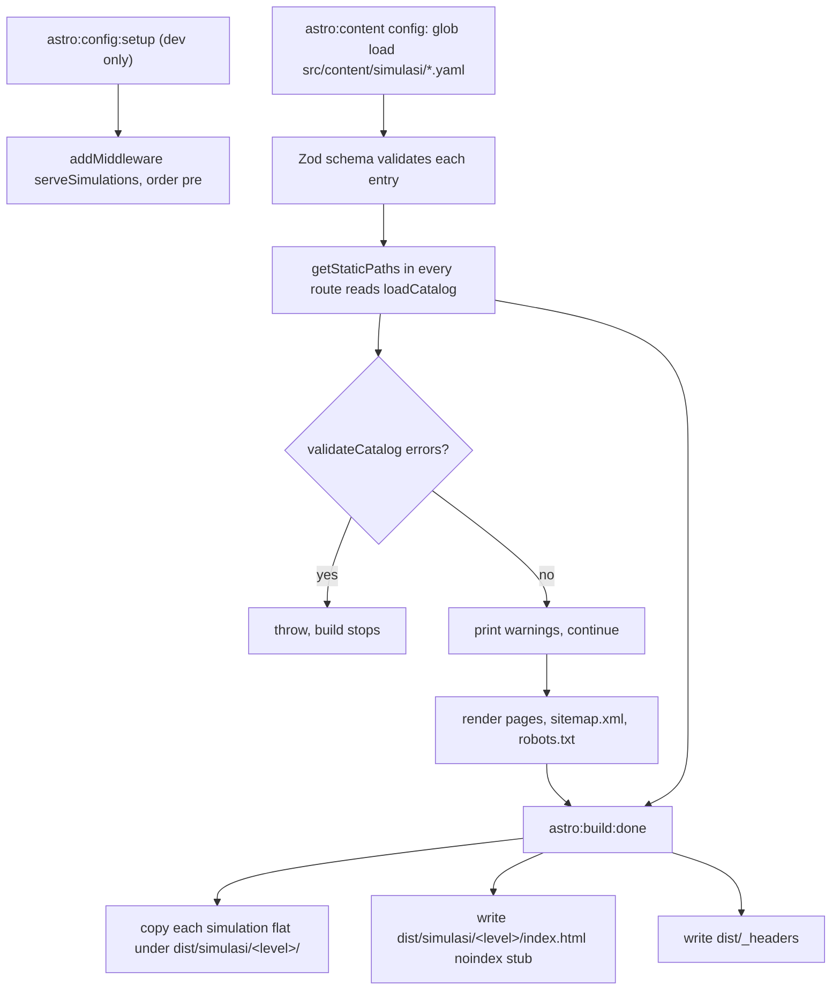

<details>
<summary>Relevant source files</summary>

The following files were used as context for generating or updating this documentation page:

- [`astro.config.mjs`](../../astro.config.mjs)
- [`src/integrations/copySimulations.ts`](../../src/integrations/copySimulations.ts)
- [`src/integrations/serveSimulations.ts`](../../src/integrations/serveSimulations.ts)
- [`src/lib/loadCatalog.ts`](../../src/lib/loadCatalog.ts)
- [`src/lib/simulations.ts`](../../src/lib/simulations.ts)
- [`src/lib/catalog.ts`](../../src/lib/catalog.ts)
- [`src/content.config.ts`](../../src/content.config.ts)
- [`package.json`](../../package.json)
- [`wrangler.jsonc`](../../wrangler.jsonc)
- [`docs/adr/0001-astro-as-static-site-generator.md`](../../docs/adr/0001-astro-as-static-site-generator.md)
- [`docs/adr/0014-serve-the-static-site-from-a-worker.md`](../../docs/adr/0014-serve-the-static-site-from-a-worker.md)
</details>

# Build Pipeline

A build is a single `astro build` that writes plain HTML into `dist/`. One Astro integration, `copySimulations`, adds the parts Astro does not know about: the raw simulation files, the `_headers` file Cloudflare reads, and a dev-only middleware that serves those same files from source. See [Architecture Overview](overview.md) for the shape of the whole site and [Simulation Discovery](../content/simulation-discovery.md) for what discovery finds.

## Commands

| Command | What it runs | Sources |
|---|---|---|
| `npm run dev` | `astro dev` | [package.json:10]() |
| `npm run build` | `astro build` | [package.json:11]() |
| `npm test` | `astro build` then `vitest run` | [package.json:15]() |
| `npm run check` | `astro check` | [package.json:13]() |
| `npm run lint` | `eslint .` | [package.json:14]() |
| `npm run verify` | check, lint, then test | [package.json:16]() |
| `npm run deploy` | `npm run build` then `wrangler deploy` | [package.json:18]() |
| `npm run deploy:preview` | `npm run build` then `wrangler dev` | [package.json:19]() |

Sources: [package.json:9-21]()

Tests read the emitted HTML in `dist/` rather than the source, because what ships is what matters. `npm test` builds first, so a stale `dist/` cannot make them pass.

Sources: [README.md:26-29]()

## Configuration

```js
export default defineConfig({
  site: 'https://simula.koosty.web.id',
  output: 'static',
  trailingSlash: 'always',
  integrations: [copySimulations()],
});
```

Sources: [astro.config.mjs:10-18]()

`output: 'static'` is Astro's default and is stated explicitly because a reader should not have to know that. `trailingSlash: 'always'` is what makes `/smp/kelas-7/` and `/smp/kelas-7` one address rather than two, and every URL helper in the site adds the slash to match.

Sources: [astro.config.mjs:8-15](), [src/lib/catalog.ts:25-33]()

## Phases



Sources: [src/integrations/copySimulations.ts:147-206](), [src/content.config.ts:18-39](), [src/lib/loadCatalog.ts:53-101]()

## The integration

`copySimulations()` registers two hooks.

### `astro:config:setup` — dev only

```ts
      'astro:config:setup': ({ command, addMiddleware }) => {
        if (command !== 'dev') return;
        addMiddleware({
          order: 'pre',
          entrypoint: fileURLToPath(new URL('./serveSimulations.ts', import.meta.url)),
        });
      },
```

Sources: [src/integrations/copySimulations.ts:158-164]()

`astro:build:done` never fires in dev, so without this middleware `/simulasi/` is empty and every Halaman Simulasi frames a 404 while the page around it looks complete. It is registered only for dev: in a build the copy is what serves the files, and a second route to the same bytes would be one more thing to keep true.

Sources: [src/integrations/copySimulations.ts:151-157]()

The middleware itself reads the file `resolveSimulationRequest` finds and returns it with `Content-Type: text/html; charset=utf-8` and `X-Robots-Tag: noindex`. Anything that is not a `/simulasi/` path is passed to `next()`.

Sources: [src/integrations/serveSimulations.ts:15-31]()

### `astro:build:done`

```ts
        for (const sim of found) {
          const level = levelForSourceFolder(sim.sourceFolder.split('/')[0]);
          if (!level) continue;

          const target = join(outDir, 'simulasi', level, basename(sim.filename));
          mkdirSync(dirname(target), { recursive: true });
          copyFileSync(join(SIMULATION_ROOT, sim.sourceFolder, sim.filename), target);
          copied += 1;
        }
```

Sources: [src/integrations/copySimulations.ts:178-186]()

Each file is copied byte for byte. Injecting a script so it could post its own height, as a resizing library would, would mean editing the tool's output, which this site never does.

Sources: [src/integrations/copySimulations.ts:119-127]()

Files land flat under their level, which is why a filename must be unique across every subject and every stage that maps to the same level — a duplicate would silently replace the first.

Sources: [src/lib/simulations.ts:100-112](), [src/integrations/copySimulations.ts:182-184]()

Each served level also gets a `dist/simulasi/<level>/index.html` — a minimal `noindex` stub — because a bare directory needs a page of its own.

Sources: [src/integrations/copySimulations.ts:188-201](), [src/integrations/copySimulations.ts:50-52]()

`dist/_headers` is written last, and holds the response headers Cloudflare serves.

Sources: [src/integrations/copySimulations.ts:203-205](), [src/integrations/copySimulations.ts:38-48]()

## Working directory

Both `SIMULATION_ROOT` constants are resolved from `process.cwd()`, not from the module's own location. Astro bundles these modules, so at run time their own directory is the emitted chunk, not `src/lib` or `src/integrations`. Every build and dev command runs from the project root.

Sources: [src/integrations/copySimulations.ts:16-22](), [src/lib/loadCatalog.ts:9-16]()

## What a build produces

| Path in `dist/` | Written by | Sources |
|---|---|---|
| `**/index.html` for every route | Astro from `getStaticPaths` | [src/pages/[tingkat]/index.astro:17-22]() |
| `sitemap.xml` | `src/pages/sitemap.xml.ts` | [src/pages/sitemap.xml.ts:15-21]() |
| `robots.txt` | `src/pages/robots.txt.ts` | [src/pages/robots.txt.ts:11-17]() |
| `simulasi/<level>/<slug>.html` | `astro:build:done` | [src/integrations/copySimulations.ts:178-186]() |
| `simulasi/<level>/index.html` | `astro:build:done` | [src/integrations/copySimulations.ts:197-201]() |
| `_headers` | `astro:build:done` | [src/integrations/copySimulations.ts:203]() |

## Serving in dev

`resolveSimulationRequest` treats the request as untrusted. It rejects anything not under `/simulasi/`, decodes the path, rejects a NUL byte, requires exactly two segments, requires a `.html` extension that does not start with a dot, then walks the tool's own output rather than rebuilding the mapping.

Sources: [src/integrations/copySimulations.ts:70-124]()

No further containment check is needed at the final join: the file name is a single segment that neither ends in anything but `.html` nor starts with a dot, and the stage, grade and subject names all come from `readdir` rather than from the request.

Sources: [src/integrations/copySimulations.ts:113-122]()

A cheap prefix check runs first so an ordinary page request never reaches the directory walk. It is a speed guard, not a security one — every request it turns away is also refused by the segment count.

Sources: [src/integrations/copySimulations.ts:74-79]()

## Related pages

- [Architecture Overview](overview.md)
- [Simulation Discovery](../content/simulation-discovery.md)
- [Catalog Model](../content/catalog-model.md)
- [Cloudflare Deployment](../deployment/cloudflare-worker.md)
- [Testing](../development/testing.md)
