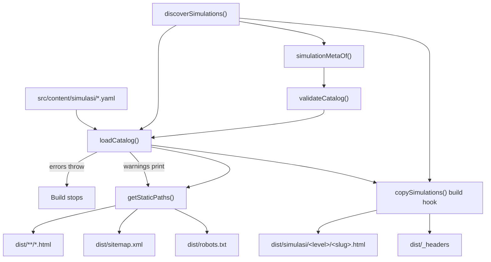

Relevant source files

The following files were used as context for generating or updating this documentation page:

- [`astro.config.mjs`](../../astro.config.mjs)
- [`package.json`](../../package.json)
- [`src/content.config.ts`](../../src/content.config.ts)
- [`src/lib/loadCatalog.ts`](../../src/lib/loadCatalog.ts)
- [`src/lib/simulations.ts`](../../src/lib/simulations.ts)
- [`src/lib/catalog.ts`](../../src/lib/catalog.ts)
- [`src/lib/types.ts`](../../src/lib/types.ts)
- [`src/integrations/copySimulations.ts`](../../src/integrations/copySimulations.ts)
- [`src/integrations/serveSimulations.ts`](../../src/integrations/serveSimulations.ts)
- [`wrangler.jsonc`](../../wrangler.jsonc)
- [`CONTEXT.md`](../../CONTEXT.md)

# Architecture Overview

Simula is a static Bahasa Indonesia website that gathers interactive learning simulations made by an external tool and helps pupils and teachers find the right one for a class. It runs no server-side code: Astro writes plain HTML into `dist/`, and a Cloudflare Worker serves those files. Nothing on the site processes, rewrites or resizes a simulation's own HTML — a simulation is copied into the build output byte for byte and framed by a generated page.

The site has exactly two kinds of content. The **Katalog** is a directory of hand-authored YAML files, one per simulation, that is the single source of truth for titles, descriptions, levels, classes, subjects and display order. The **simulasi** are the raw HTML files the external tool produces, stored on disk in the tool's own English folder layout. Everything the site publishes — the navigation, the landing pages, the Katalog listing, the printable sheets, the sitemap — is derived from the Katalog at build time.

## Vocabulary

The repository fixes its own terms in [`CONTEXT.md`](../../CONTEXT.md), and the code follows them. A **Simulasi** is one self-contained HTML file teaching one concept. A **Katalog** is the site's complete list, assembled at build time. A **Halaman Simulasi** is the generated page that wraps one simulation. **Tingkat**, **Kelas**, **Mata Pelajaran** and **Konsep** are the classification terms; **Mata Pelajaran** is deliberately an open set with no fixed list. A **Daftar Cetak** is the printable per-class list.

Sources: [CONTEXT.md:1-45]()

## Technology

| Concern | Choice | Evidence |
|---|---|---|
| Framework | Astro `^7.3.8`, `output: 'static'` | [astro.config.mjs:10-18](), [package.json:22-24]() |
| Content | Astro content collection `simulasi`, glob loader over `src/content/simulasi` | [src/content.config.ts:18-41]() |
| Integration | One Astro integration, `copySimulations()`, registered in the config | [astro.config.mjs:17](), [src/integrations/copySimulations.ts:129-131]() |
| Hosting | Cloudflare Worker serving `./dist` as static assets | [wrangler.jsonc:23-25]() |
| URL shape | Every URL ends in a slash: `trailingSlash: 'always'` | [astro.config.mjs:15]() |
| Language | TypeScript with `astro check`; ESLint with `eslint-plugin-astro` | [package.json:26-35]() |
| Tests | Vitest, run against built output after a build | [package.json:15]() |

## The build in one pass

Sources: [src/lib/loadCatalog.ts:53-101](), [src/integrations/copySimulations.ts:132-180]()

Errors from `validateCatalog` throw out of `loadCatalog` and stop the build; warnings are printed in yellow and the build continues, because the Katalog is authoritative and a disagreement is a signal to look rather than a reason to block a publish.

## Trust boundaries

Two decisions shape everything else:

1. **The Katalog is authoritative.** Simulations declare their own `education_levels`, `grade` and a `<title>`, but those are read only to warn when they disagree. They never fill a gap in a catalog entry.
   Sources: [src/lib/simulations.ts:126-141](), [src/lib/catalog.ts:58-70](), [docs/adr/0004-catalog-file-is-authoritative.md:1-3]()
2. **A simulation file is never edited.** Its `noindex` is delivered as an HTTP header rather than by touching the file, and its frame height is measured by reading the child's rendered box bounds rather than by injecting a script into it.
   Sources: [src/integrations/copySimulations.ts:23-38](), [src/lib/frame.ts:1-15]()

## Related pages

- [Build Pipeline](build-pipeline.md) — how one build runs, hook by hook.
- [Catalog Model](../content/catalog-model.md) — the fields, the schema and the validation rules.
- [Simulation Discovery](../content/simulation-discovery.md) — how the tool's English folders become Indonesian URL segments.
- [Publishing Simulations](../development/publishing-simulations.md) — the batch script that writes files and entries.
- [Cloudflare Deployment](../deployment/cloudflare-worker.md) — hosting, headers and the deploy hook.
- [Architecture Decisions](decisions.md) — what the ADRs decided and where they live.
