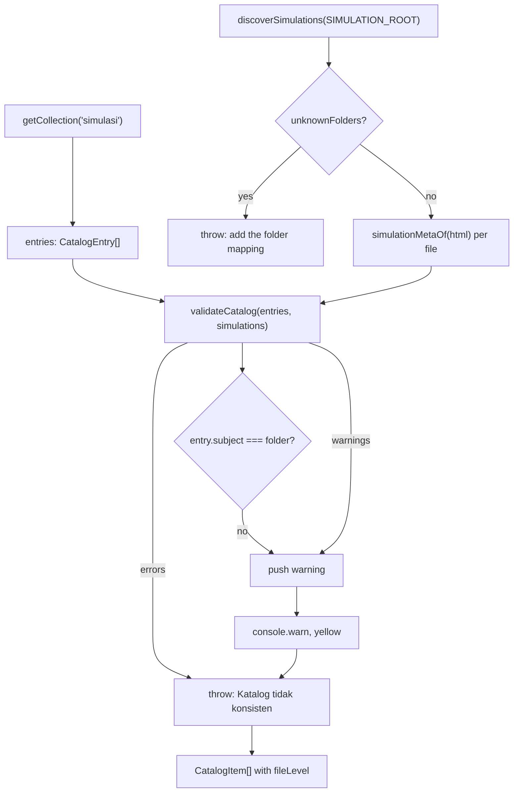

<details>
<summary>Relevant source files</summary>

The following files were used as context for generating or updating this documentation page:

- [`src/content.config.ts`](../../src/content.config.ts)
- [`src/lib/types.ts`](../../src/lib/types.ts)
- [`src/lib/loadCatalog.ts`](../../src/lib/loadCatalog.ts)
- [`src/lib/catalog.ts`](../../src/lib/catalog.ts)
- [`src/lib/simulations.ts`](../../src/lib/simulations.ts)
- [`src/lib/publish.ts`](../../src/lib/publish.ts)
- [`src/content/simulasi/difusi.yaml`](../../src/content/simulasi/difusi.yaml)
- [`docs/adr/0004-catalog-file-is-authoritative.md`](../../docs/adr/0004-catalog-file-is-authoritative.md)
- [`docs/adr/0006-catalog-file-carries-slug-order-and-trigger.md`](../../docs/adr/0006-catalog-file-carries-slug-order-and-trigger.md)
</details>

# Catalog Model

The Katalog is the site's complete list of simulations, assembled at build time from one YAML file per simulation. It is authoritative: it, not a simulation's own HTML metadata, decides what the site publishes. Each entry's filename *is* its slug, so there is one file per address and no second source of truth for the URL.

Entries live in [`src/content/simulasi/`](../../src/content/simulasi/) and are loaded through Astro's content collection `simulasi`, which validates them with a Zod schema before any page sees them. See [Architecture Overview](../architecture/overview.md) for how the Katalog fits into the whole build, and [Publishing Simulations](../development/publishing-simulations.md) for how entries are written in bulk.

## Fields

| Field | Type | Required | Rule | Meaning |
|---|---|---|---|---|
| `title` | string | Yes | `min(1)` | Bahasa Indonesia title shown on cards, headings and the sheet. |
| `description` | string | Yes | `min(1)` | Bahasa Indonesia description, used on cards and in meta tags. |
| `level` | string | Yes | `min(1)`, free-form | Indonesian URL segment for the Tingkat, e.g. `smp`. |
| `grade` | number | Yes | integer, 1–12 | The Kelas. |
| `subject` | string | Yes | `min(1)`, free-form | Indonesian URL segment for the Mata Pelajaran, e.g. `ipa`. |
| `order` | number | Yes | integer, `min(1)` | Display order within a class — the only prominence signal. |
| `scene` | string | No | `min(1)` | The tool's scene id this was published from, e.g. `s9`. |

The `slug` is not a field. It is the collection entry's `id`, which the glob loader takes from the filename without `.yaml`.

Sources: [src/content.config.ts:18-38](), [src/lib/types.ts:1-23](), [src/lib/loadCatalog.ts:32-42]()

`level` and `subject` are free-form strings rather than enums on purpose: Mata Pelajaran is an open set, and a fixed list would fail the build the first time a new subject arrived.

Sources: [src/content.config.ts:13-16](), [CONTEXT.md:27-29]()

### Why `scene` is optional

`scene` is what ties a published URL to a scene rather than to a title. The tool rewrites a title when it corrects a simulation, and re-slugifying that would move an address search results already point at. Entries published before the field existed do not have one; those fall back to matching on the slug their own title produces.

Sources: [src/content.config.ts:27-37](), [src/lib/types.ts:14-22](), [docs/adr/0007-replacement-keeps-the-url.md:1-3]()

## An entry on disk

Every entry the publish script writes carries the same three-line comment header. [`src/content/simulasi/difusi.yaml`](../../src/content/simulasi/difusi.yaml):

```yaml
# Satu entri katalog per simulasi. Kunci adalah pengenal bahasa Inggris;
# nilainya Bahasa Indonesia karena menjadi bagian URL.
# Katalog adalah sumber kebenaran atas metadata simulasi (docs/adr/0004).
title: "Difusi"
description: >-
  Mengamati perpindahan partikel dari konsentrasi tinggi ke rendah.
level: smp
grade: 7
subject: ipa
order: 32
scene: "s9"
```

Sources: [src/content/simulasi/difusi.yaml:1-11](), [scripts/publish-batch.mjs:216-228]()

## Loading

`loadCatalog()` is the single door into the Katalog. It loads the collection, scans the simulation files on disk, cross-checks the two, prints warnings, throws on errors, and returns the entries with the level of the source folder each file actually came from.



Sources: [src/lib/loadCatalog.ts:53-101]()

Two return shapes exist. `loadCatalog()` returns `CatalogItem[]`, which adds `fileLevel` — the Indonesian level of the folder the file was found in. `loadCatalogEntries()` drops that field for pages that have no use for it, so a future build-only field does not mean editing every page.

Sources: [src/lib/loadCatalog.ts:27-30](), [src/lib/loadCatalog.ts:111-113]()

`fileLevel` exists because the build hook writes each simulation under the level its *folder* implies. Deriving the iframe path from the catalog entry instead would let an entry naming the wrong level publish a page whose simulation 404s, since a level disagreement is only a warning.

Sources: [src/lib/loadCatalog.ts:18-26](), [src/integrations/copySimulations.ts:140-149]()

## Validation rules

`validateCatalog` splits every problem into errors that stop the build and warnings that do not.

| Condition | Severity | Why |
|---|---|---|
| An entry names a file that is not on disk | Error | Would publish a page whose simulation is missing. |
| A simulation file has no catalog entry | Error | Would be invisible and unlinked. |
| Two entries share a slug | Error | Two pages at one address; only one could ever be real. |
| A file sits directly in a grade folder, not under a subject | Error (throws in `discoverSimulations`) | It has no subject, so it would be filed under whichever the catalog names. |
| The same filename appears in two source folders | Error (throws in `discoverSimulations`) | The copy step writes every simulation flat under its level, so a duplicate name silently replaces the first. |
| `grade` disagrees with the file's own `<meta name="grade">` | Warning | The Katalog is authoritative; a mismatch is a signal to look. |
| `level` disagrees with the file's `education_levels` | Warning | Same. An unknown level passes through unchanged so a mismatch is reported rather than quietly passing. |
| `order` is used by more than one entry | Warning | Order is a sort key; a tie makes the listing unstable. |
| `subject` disagrees with the file's folder | Warning | Added by `loadCatalog`, not by `validateCatalog`. |
| An unknown simulation source folder exists | Error (throws) | Those simulations would be silently uncatalogued. |

Sources: [src/lib/catalog.ts:67-143](), [src/lib/loadCatalog.ts:57-62](), [src/lib/loadCatalog.ts:75-95](), [src/lib/simulations.ts:82-112]()

The duplicate-slug check is unreachable today — entries are files named `<slug>.yaml`, so two files mean two slugs — but it stays because the guarantee belongs to the Katalog rather than to one loader's behaviour, and ADR 0006 records that a separate slug field was dropped.

Sources: [src/lib/catalog.ts:93-110](), [docs/adr/0006-catalog-file-carries-slug-order-and-trigger.md:1-3]()

Errors throw one combined `Error` whose message lists every failure, so one build run reports all of them rather than one at a time.

Sources: [src/lib/loadCatalog.ts:90-95]()

## URLs derived from an entry

`simulasiUrlSegments` builds the four route segments; `simulasiUrl` joins them with a trailing slash, which the site requires because it builds with `trailingSlash: 'always'`.

Sources: [src/lib/catalog.ts:11-22](), [src/lib/catalog.ts:33](), [astro.config.mjs:13-15]()

```ts
export function simulasiUrlSegments(
  entry: Pick<CatalogEntry, 'level' | 'grade' | 'subject' | 'slug'>,
): { tingkat: string; kelas: string; mataPelajaran: string; slug: string } {
  return {
    tingkat: entry.level,
    kelas: `kelas-${entry.grade}`,
    mataPelajaran: entry.subject,
    slug: entry.slug,
  };
}
```

Sources: [src/lib/catalog.ts:11-22]()

The class segment is `kelas-7`, not a bare `7`, so a URL reads as a sentence to someone who has never seen the site. The Bahasa segment order — level, class, subject, slug — is ADR 0003.

Sources: [src/lib/catalog.ts:17-20](), [docs/adr/0003-bahasa-url-path-segments.md:1-3]()

## Adding a simulation by hand

Renaming a simulation file by hand fails the build, because its catalog entry then points at a file that is not there. The supported route is the publish script, which writes both files together.

Sources: [src/lib/catalog.ts:75-82](), [README.md:152-153]()

A stage, class or subject with no entry yet publishes no landing page and appears in no navigation — pages are derived, not listed in advance.

Sources: [src/lib/landing.ts:68-77](), [src/lib/nav.ts:27-33]()

## Related pages

- [Architecture Overview](../architecture/overview.md)
- [Simulation Discovery](simulation-discovery.md)
- [Publishing Simulations](../development/publishing-simulations.md)
- [Landing Pages](../features/landing-pages.md)
- [Printable Class Sheet](../features/printable-class-sheet.md)
