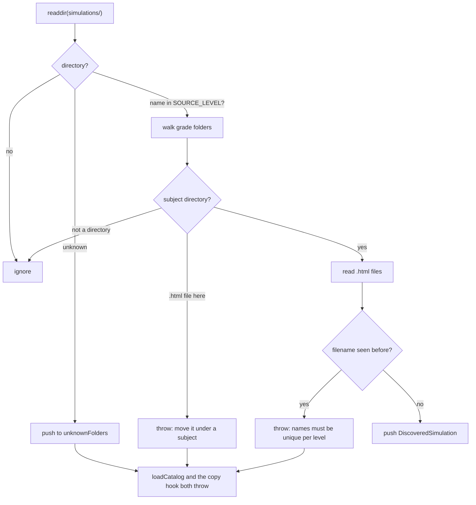

<details>
<summary>Relevant source files</summary>

The following files were used as context for generating or updating this documentation page:

- [`src/lib/simulations.ts`](../../src/lib/simulations.ts)
- [`src/lib/loadCatalog.ts`](../../src/lib/loadCatalog.ts)
- [`src/integrations/copySimulations.ts`](../../src/integrations/copySimulations.ts)
- [`src/integrations/serveSimulations.ts`](../../src/integrations/serveSimulations.ts)
- [`src/lib/catalog.ts`](../../src/lib/catalog.ts)
- [`src/lib/publish.ts`](../../src/lib/publish.ts)
- [`scripts/publish-batch.mjs`](../../scripts/publish-batch.mjs)
- [`test/discover-simulations.test.ts`](../../test/discover-simulations.test.ts)
- [`docs/adr/0003-bahasa-url-path-segments.md`](../../docs/adr/0003-bahasa-url-path-segments.md)
- [`docs/adr/0011-simulations-are-grouped-by-subject-on-disk.md`](../../docs/adr/0011-simulations-are-grouped-by-subject-on-disk.md)
</details>

# Simulation Discovery

Simulations arrive from an external tool as HTML files in that tool's own English folder layout. `src/lib/simulations.ts` is the one place that knows how those folders become the Indonesian URL segments the site serves, and `discoverSimulations` walks them to find every file. See [Catalog Model](catalog-model.md) for what happens to what is found, and [Build Pipeline](../architecture/build-pipeline.md) for where discovery runs.

## On-disk layout

```
simulations/
└── lower-secondary/
    └── grade-7/
        ├── ipa/
        │   ├── difusi.html
        │   └── …
        └── matematika/
            ├── sudut-dalam-segitiga.html
            └── …
```

A simulation's place on disk says what it is: its stage, its class, and its subject. Simulating this layout the repository holds 71 HTML files under one stage, one grade and two subjects.

Sources: [`simulations/`](../../simulations/), [docs/adr/0011-simulations-are-grouped-by-subject-on-disk.md:1-3]()

`simulationPathFor` writes files under the tool's own English folder rather than the Indonesian segment. The scanner walks `simulations/<stage>/<grade>/<subject>/` and maps the stage at build time, so writing under `smp` would put the file where the scanner never looks, and the build would report a catalog entry with no file.

Sources: [src/lib/publish.ts:266-276](), [src/lib/simulations.ts:59-123]()

## Level mappings

The tool writes English folders; the site serves Indonesian URLs. Two mappings exist because a folder name and the wording inside a simulation's metadata differ.

Folder name → URL segment (`SOURCE_LEVEL`):

| Source folder | Segment |
|---|---|
| `primary` | `sd` |
| `lower-secondary` | `smp` |
| `middle-school` | `smp` |
| `upper-secondary` | `sma` |

Sources: [src/lib/simulations.ts:39-44](), [src/lib/simulations.ts:46-49]()

Metadata wording → URL segment (`LEVEL_BY_SIMULATION_NAME`):

| Wording | Segment |
|---|---|
| `primary` | `sd` |
| `lower secondary` | `smp` |
| `middle school` | `smp` |
| `uppersecondary` | `sma` |
| `upper secondary` | `sma` |

Sources: [src/lib/simulations.ts:32-38]()

`levelForSourceFolder` returns `null` for an unknown folder rather than guessing. A level can have more than one source folder — `lower-secondary` and `middle-school` are both `smp` — so consumers try every folder that maps to the level they are serving.

Sources: [src/lib/simulations.ts:46-49](), [src/integrations/copySimulations.ts:105-113]()

`levelToSegment` in the catalog maps a simulation's own metadata level, returning an unknown value unchanged so a mismatch is reported rather than quietly passing.

Sources: [src/lib/catalog.ts:47-55]()

## The scan

```ts
export interface DiscoveredSimulation {
  filename: string;
  /** Source folder, e.g. "lower-secondary/grade-7/matematika". */
  sourceFolder: string;
  html: string;
}

export interface SimulationScan {
  found: DiscoveredSimulation[];
  /** Folders the site has no Indonesian segment for. Never dropped silently. */
  unknownFolders: string[];
}
```

Sources: [src/lib/simulations.ts:6-19]()

Folders are walked rather than listed, so a batch the tool adds later needs no change here. A missing `simulations/` directory is not an error: the Katalog can be built before the first batch arrives.

Sources: [src/lib/simulations.ts:51-58](), [src/lib/simulations.ts:59-79]()



Sources: [src/lib/simulations.ts:59-123](), [src/lib/loadCatalog.ts:57-62](), [src/integrations/copySimulations.ts:134-139]()

Three things stop a build outright, all with an explicit message rather than a silent skip:

- **A simulation sitting directly in a grade folder.** It has no subject, so it would be filed under whichever subject the catalog happens to name. It is refused rather than guessed at.
  Sources: [src/lib/simulations.ts:86-94]()
- **A filename used twice across subjects or stages that map to the same level.** The copy step writes every simulation flat under its level, so a duplicate name would silently replace the first.
  Sources: [src/lib/simulations.ts:100-112](), [src/integrations/copySimulations.ts:140-149]()
- **An unknown stage folder.** Those simulations would be silently uncatalogued, and the catalog checks would never get the chance to complain.
  Sources: [src/lib/simulations.ts:66-69](), [src/lib/simulations.ts:16-19]()

An unknown folder is reported rather than skipped on purpose.

Sources: [src/lib/simulations.ts:51-58]()

## Reading a simulation's own metadata

```ts
export function simulationMetaOf(html: string): SimulationMeta {
  const title = html.match(/<title>([\s\S]*?)<\/title>/)?.[1]?.trim() ?? '';
  const grade = html.match(/<meta\s+name="grade"\s+content="(\d+)"/)?.[1];
  return {
    title: title.split('\u00b7')[0].trim(),
    grade: grade ? Number(grade) : Number.NaN,
    level: html.match(/<meta\s+name="education_levels"\s+content="([^"]*)"/)?.[1]?.trim() ?? '',
  };
}
```

Sources: [src/lib/simulations.ts:131-141]()

This is used only to warn when a simulation disagrees with its catalog entry, never to fill a gap, because the Katalog is authoritative. The title carries a course suffix after a middle dot, so the simulation's own name is what comes before it.

Sources: [src/lib/simulations.ts:125-130](), [docs/adr/0004-catalog-file-is-authoritative.md:1-3]()

A missing or unreadable grade becomes `Number.NaN`, and `validateCatalog` skips it: `Number.isFinite(meta.grade)` gates the comparison, so a file with no grade meta produces no warning at all rather than a false one.

Sources: [src/lib/catalog.ts:113-121]()

## Where discovery runs

| Consumer | What it takes from discovery | Sources |
|---|---|---|
| `loadCatalog()` | Filenames, source folders and HTML, to validate entries and attach `fileLevel` | [src/lib/loadCatalog.ts:55-73]() |
| `copySimulations()` build hook | Filenames and source folders, to copy each file flat under its level | [src/integrations/copySimulations.ts:134-165]() |
| `resolveSimulationRequest()` | Not `discoverSimulations` — it walks the same tree directly for a single dev request | [src/integrations/copySimulations.ts:96-124]() |

The dev middleware serves the same bytes from source that the build copies, because `astro:build:done` never fires in dev and the whole `/simulasi/` directory would otherwise be missing — a Halaman Simulasi would frame a 404 while the page around it looked complete.

Sources: [src/integrations/serveSimulations.ts:1-13](), [src/integrations/copySimulations.ts:133-143](), [src/integrations/copySimulations.ts:184-189]()

The middleware sends `X-Robots-Tag: noindex` to match the header the deployed site sends through `_headers`, so a dev server exposed beyond localhost is as unindexable as production.

Sources: [src/integrations/serveSimulations.ts:15-29](), [src/integrations/copySimulations.ts:29-37]()

Every request that is not a `/simulasi/` path is passed straight through, including the site's own pages.

Sources: [src/integrations/serveSimulations.ts:11-18]()

## Testing

- [`test/discover-simulations.test.ts`](../../test/discover-simulations.test.ts)
- [`test/copy-simulations.test.ts`](../../test/copy-simulations.test.ts)

## Related pages

- [Catalog Model](catalog-model.md)
- [Build Pipeline](../architecture/build-pipeline.md)
- [Publishing Simulations](../development/publishing-simulations.md)
- [Simulation Page](../features/simulation-page.md)
- [Cloudflare Deployment](../deployment/cloudflare-worker.md)
