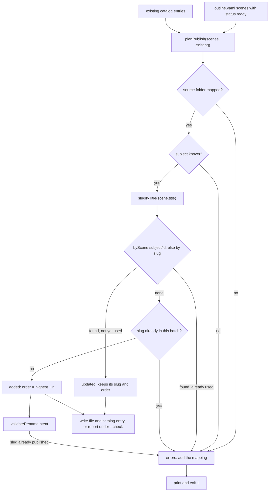

<details>
<summary>Relevant source files</summary>

The following files were used as context for generating or updating this documentation page:

- [`scripts/publish-batch.mjs`](../../scripts/publish-batch.mjs)
- [`src/lib/publish.ts`](../../src/lib/publish.ts)
- [`src/lib/deployHook.ts`](../../src/lib/deployHook.ts)
- [`scripts/backfill-scene-ids.mjs`](../../scripts/backfill-scene-ids.mjs)
- [`src/lib/simulations.ts`](../../src/lib/simulations.ts)
- [`src/lib/loadCatalog.ts`](../../src/lib/loadCatalog.ts)
- [`src/content.config.ts`](../../src/content.config.ts)
- [`package.json`](../../package.json)
- [`test/publish.test.ts`](../../test/publish.test.ts)
- [`docs/adr/0007-replacement-keeps-the-url.md`](../../docs/adr/0007-replacement-keeps-the-url.md)
- [`docs/adr/0012-a-scene-id-names-one-simulation-within-its-subject.md`](../../docs/adr/0012-a-scene-id-names-one-simulation-within-its-subject.md)
</details>

# Publishing Simulations

`npm run publish` reads an external tool's outline and scene files, decides what each scene would do to the site, and writes the simulation files and their catalog entries. Nothing is renamed, deleted or renumbered. Run with `--check` it writes nothing and only reports, which is what a hook should call to find out whether there is anything to publish.

See [Catalog Model](../content/catalog-model.md) for what the written entries mean and [Simulation Discovery](../content/simulation-discovery.md) for the layout they are written into.

## Usage

```
SIMULA_TOOL_REPO=/path/to/simula-w npm run publish
```

Sources: [scripts/publish-batch.mjs:2-25](), [README.md:108-113]()

| Flag | Default | Effect |
|---|---|---|
| `--tool <path>` | `$SIMULA_TOOL_REPO` | The tool's repository root, or the course directory inside it. |
| `--check` | off | Decide and report; write nothing. |
| `--trigger` | off | POST the deploy hook when done. |
| `--subject <mapel>` | read from the course folder name | Override the Mata Pelajaran. |
| `--stage <stage>` | read from the course folder name | One of `primary`, `lower-secondary`, `upper-secondary`. |
| `--grade <n>` | read from `outline.grade` | The grade number. |

Sources: [scripts/publish-batch.mjs:49-64](), [scripts/publish-batch.mjs:157-161]()

The path may be the tool's repository root or the course directory inside it. `findCourseDir` accepts either: a directory holding `outline.yaml`, or a `courses/` directory with exactly one course in it. More than one course is an error naming all of them.

Sources: [scripts/publish-batch.mjs:76-88]()

## Resolving stage, grade and subject

```ts
function sourceFolderFor(courseFolder, outline, overrides) {
  const stage = { sd: 'primary', smp: 'lower-secondary', sma: 'upper-secondary' };
  const named = courseFolder.match(/-(sd|smp|sma)-/);
  const fromName = named ? stage[named[1]] : null;
  const chosenStage = overrides.stage ?? fromName;
```

Sources: [scripts/publish-batch.mjs:109-112]()

The tool names a course `<mapel>-<tingkat>-kelas-<romawi>`, so the school level is in the name. Guessing `lower-secondary` for every course would file an SMA scene under SMP and publish it at an address that 404s.

Sources: [scripts/publish-batch.mjs:93-96](), [src/lib/publish.ts:209-221]()

Not every course is named that way. `ipa-kelas-7-kurikulum-merdeka` says neither the school level nor the level in the form the name uses, so `--subject`, `--stage` and `--grade` say it instead. They override the name whatever it holds.

Sources: [scripts/publish-batch.mjs:97-108](), [README.md:123-131]()

The subject is the segment before the school level, lower-cased:

```ts
export function subjectOf(courseFolder: string): string | null {
  const match = courseFolder.match(/^(.+)-(?:smp|sma|sd|smk)-/);
  if (!match) return null;
  return match[1].toLowerCase();
}
```

Sources: [src/lib/publish.ts:217-221]()

## Planning



Sources: [src/lib/publish.ts:89-186](), [scripts/publish-batch.mjs:167-186]()

An entry is recognised by the scene it came from where it records one, and by its slug otherwise. That order matters: the tool rewrites a scene's title when it corrects the simulation, so matching on the title alone would publish the correction under a new slug and strand an address search results already point at.

Sources: [src/lib/publish.ts:96-110](), [docs/adr/0007-replacement-keeps-the-url.md:1-3]()

The scene lookup key carries the subject, because a scene id counts one course's scenes: two subjects each have an `s2`, and keying on the id alone would keep only one of them, so the other would be published a second time on every run.

Sources: [src/lib/publish.ts:96-105](), [src/lib/publish.ts:135-141](), [docs/adr/0012-a-scene-id-names-one-simulation-within-its-subject.md:1-3]()

## Slugs

```ts
export function slugifyTitle(title: string): string {
  const base = title.split(COURSE_SEPARATOR)[0].trim();
  const slug = base
    .toLowerCase()
    .replace(/[^a-z0-9]+/g, '-')
    .replace(/^-+|-+$/g, '');
  if (slug === '') {
    throw new Error(`Judul "${title}" tidak menghasilkan slug yang bisa dipakai sebagai URL.`);
  }
  return slug;
}
```

Sources: [src/lib/publish.ts:65-75]()

The course suffix the tool appends after a middle dot is dropped. Every run of non-alphanumerics reduces to one hyphen — including a hyphen already inside a word, which Indonesian uses as a hyphen rather than a separator.

Sources: [src/lib/publish.ts:56-64](), [README.md:141-142]()

## What it will not do

| Refusal | Where | Sources |
|---|---|---|
| Rename or delete. A corrected simulation keeps its filename, entry and URL. | `planPublish` | [src/lib/publish.ts:76-88]() |
| Renumber. A new simulation is placed after everything already published. | `renumberNew` | [src/lib/publish.ts:229-236]() |
| Take a published address. | `validateRenameIntent` | [src/lib/publish.ts:245-259]() |
| Publish one scene twice. | `planPublish` | [src/lib/publish.ts:143-152]() |
| Give two scenes in one batch the same slug. | `planPublish` | [src/lib/publish.ts:154-161]() |

A published order is already in the search index, so renumbering would move every later simulation for no gain.

Sources: [src/lib/publish.ts:223-228]()

## Writing

```ts
export function catalogPathFor(slug: string): string {
  return `src/content/simulasi/${slug}.yaml`;
}

export function simulationPathFor(sourceFolder: string, slug: string): string {
  return `simulations/${sourceFolder}/${slug}.html`;
}
```

Sources: [src/lib/publish.ts:262-264](), [src/lib/publish.ts:275-277]()

The simulation file is copied byte for byte from the tool's scene file. This site never edits it; a simulation broken on its own terms is fixed where it lives, and its `noindex` is delivered as a header.

Sources: [scripts/publish-batch.mjs:230-241](), [docs/adr/0005-embed-simulations-in-iframe.md:19-25]()

```ts
    `title: ${JSON.stringify(simulation.title)}`,
    `description: >-`,
    `  ${simulation.description}`,
    `level: ${simulation.level}`,
    `grade: ${simulation.grade}`,
    `subject: ${simulation.subject}`,
    `order: ${simulation.order}`,
    `scene: ${JSON.stringify(simulation.scene)}`,
```

Sources: [scripts/publish-batch.mjs:211-226]()

The script never commits or pushes. Whoever runs it decides what goes into git — a hook on another host may do that part itself.

Sources: [README.md:182-184]()

## Deploy hook

With `--trigger`, the script POSTs to `$SIMULA_DEPLOY_HOOK` after the batch is written.

```ts
export function checkDeployHook(raw: string | undefined): { url: URL } | { error: string } {
  if (!raw) {
    return { error: 'SIMULA_DEPLOY_HOOK belum disetel.' };
  }
```

Sources: [src/lib/deployHook.ts:23-26](), [scripts/publish-batch.mjs:254](), [scripts/publish-batch.mjs:263-265]()

The URL is the credential. It is pasted by hand out of a Cloudflare dashboard, so it arrives with the typos a paste brings: a truncated string, a stray space, or a URL from somewhere else entirely. Posting it to whatever host it happens to name would hand that credential to a third party, so it must be `https` on `api.cloudflare.com`.

Sources: [src/lib/deployHook.ts:1-11](), [src/lib/deployHook.ts:36-45](), [README.md:163-176]()

| Situation | Behaviour | Sources |
|---|---|---|
| Unset | Warning; the batch is on disk and can be pushed by hand. | [scripts/publish-batch.mjs:266-273]() |
| Present but invalid | Error and exit 1; the batch is already written. | [scripts/publish-batch.mjs:274-277]() |
| Valid | `fetch` POST with `AbortSignal.timeout(DEPLOY_HOOK_TIMEOUT_MS)`. | [scripts/publish-batch.mjs:284-287]() |
| Non-OK answer, or no answer | Error and exit 1, noting the batch is written. | [scripts/publish-batch.mjs:288-300]() |

The timeout is 30 seconds. A hook that never answers would otherwise hang the publish forever with the batch already on disk and no explanation.

Sources: [scripts/publish-batch.mjs:39-47](), [scripts/publish-batch.mjs:278-292]()

## Backfill script

`scripts/backfill-scene-ids.mjs` is a one-off that records which tool scene each pre-existing entry came from. It matches by the slug the entry's own title produces, reports an unmatched or ambiguous slug and leaves it alone rather than guessing, and writes only with `--write`.

Sources: [scripts/backfill-scene-ids.mjs:1-15](), [scripts/backfill-scene-ids.mjs:59-107]()

Two scenes reducing to one slug is a collision the publisher reports, and here it means neither can be matched, so both are reported and neither is touched.

Sources: [scripts/backfill-scene-ids.mjs:60-67]()

## Related pages

- [Catalog Model](../content/catalog-model.md)
- [Simulation Discovery](../content/simulation-discovery.md)
- [Cloudflare Deployment](../deployment/cloudflare-worker.md)
- [Testing](testing.md)
- [Architecture Decisions](../architecture/decisions.md)
