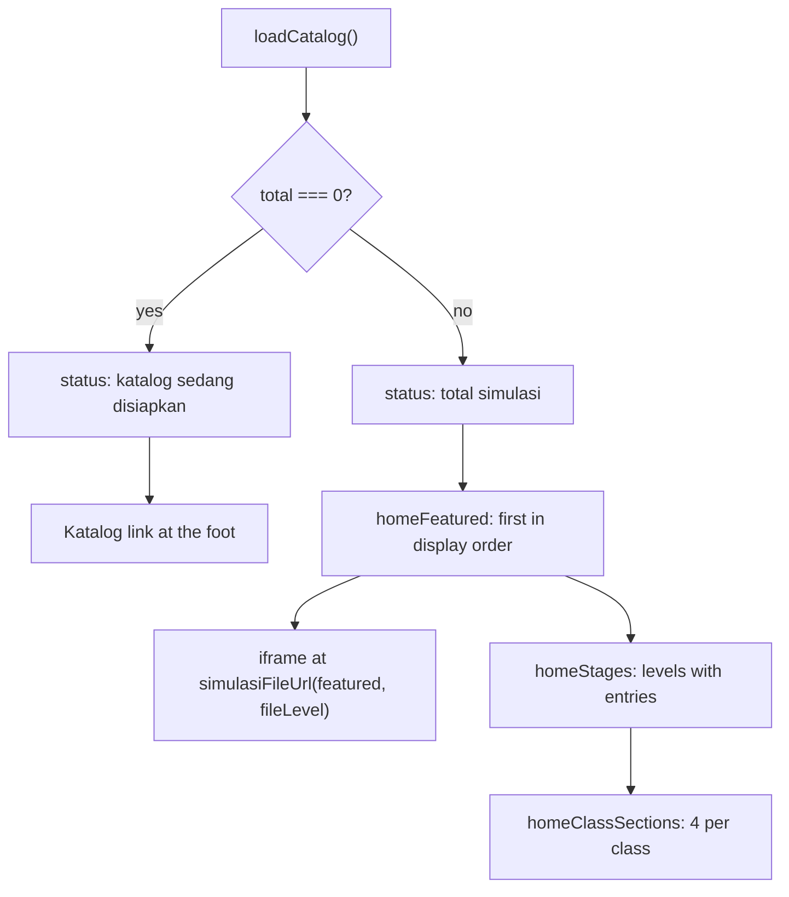

<details>
<summary>Relevant source files</summary>

The following files were used as context for generating or updating this documentation page:

- [`src/pages/index.astro`](../../src/pages/index.astro)
- [`src/lib/home.ts`](../../src/lib/home.ts)
- [`src/lib/katalogFilter.ts`](../../src/lib/katalogFilter.ts)
- [`src/lib/landing.ts`](../../src/lib/landing.ts)
- [`src/lib/tingkat.ts`](../../src/lib/tingkat.ts)
- [`src/lib/catalog.ts`](../../src/lib/catalog.ts)
- [`src/lib/loadCatalog.ts`](../../src/lib/loadCatalog.ts)
- [`src/layouts/Base.astro`](../../src/layouts/Base.astro)
- [`test/home.test.ts`](../../test/home.test.ts)
- [`test/home-logic.test.ts`](../../test/home-logic.test.ts)
- [`test/landing-page.test.ts`](../../test/landing-page.test.ts)
- [`docs/adr/0010-site-keeps-its-own-dark-palette.md`](../../docs/adr/0010-site-keeps-its-own-dark-palette.md)
</details>

# Home Page

The home page at `/` is the only page that opens with a live simulation. It is laid out as a lab bench: a featured simulation framed on the right, the words on the left, then a link per school stage and a preview of each class. See [Site Navigation](site-navigation.md) for the shared layout and [Katalog Page](katalog-page.md) for the full list.

## Data

```astro
const catalog = await loadCatalog();
const featured = homeFeatured(catalog);
const classes = homeClassSections(catalog);
const stages = homeStages(catalog);
const total = catalog.length;
```

Sources: [src/pages/index.astro:12-17]()

This page calls `loadCatalog()` rather than `loadCatalogEntries()`, because the featured frame needs `fileLevel` to build the raw file URL.

Sources: [src/pages/index.astro:8-12](), [src/pages/index.astro:70]()

## Featured simulation

`homeFeatured` returns the first simulation in display order, or `null` when the catalog is empty so the page shows no frame rather than a broken one. A class works through the syllabus front to back, so the start is where a pupil begins and the page can say so plainly.

Sources: [src/lib/home.ts:9-19]()

```astro
            <iframe
              src={simulasiFileUrl(featured, featured.fileLevel)}
              title={featured.title}
            ></iframe>
```

Sources: [src/pages/index.astro:69-72]()

This iframe is simpler than the one on a [Halaman Simulasi](simulation-page.md): it carries no `id`, no `loading` and no `data-*` heights, and nothing resizes it. The frame's edge is visible on purpose — the home page is built around the framed simulation, so a seam is the point of the layout.

Sources: [src/pages/index.astro:66-83](), [docs/adr/0010-site-keeps-its-own-dark-palette.md:5-13]()

A fallback link follows the frame, pointing at the same raw file in a new tab.

Sources: [src/pages/index.astro:73-80]()

The featured block renders only when `featured` is truthy, in both the text column and the frame column.

Sources: [src/pages/index.astro:50-51](), [src/pages/index.astro:66-67]()

## Stages

`homeStages` lists every stage holding at least one simulation, from primary upwards, with a count behind each link. A stage with nothing in it is absent rather than shown as empty, which is what keeps the home page from advertising four stages and delivering one.

Sources: [src/lib/home.ts:63-95]()

The stage block renders only when `stages.length > 0`, and ends with a link to the Katalog.

Sources: [src/pages/index.astro:86-104]()

## Class previews

`homeClassSections` returns every populated class in school order, each with its first `HOME_CLASS_PREVIEW_SIZE` (4) simulations and the path to the whole class. A preview is a way in rather than a wall.

Sources: [src/lib/home.ts:44-53](), [src/lib/home.ts:7](), [src/lib/home.ts:29-42]()

| Element | Content | Sources |
|---|---|---|
| Section heading | `section.label`, id `kelas-${key.replace('/', '-')}` | [src/pages/index.astro:108-109]() |
| Card title | Link to `simulasiUrl(entry)` | [src/pages/index.astro:112-115]() |
| Card description | `entry.description` | [src/pages/index.astro:116]() |
| Section footer | `Lihat {total} simulasi di {label}` linking to `section.path` | [src/pages/index.astro:120-122]() |

## Empty catalog

The page answers an empty catalog rather than failing:

| Block | Condition | Sources |
|---|---|---|
| Status line | `total === 0` → "Katalog ini sedang disiapkan…" | [src/pages/index.astro:36-48]() |
| Status line | otherwise → "Saat ini ada {total} simulasi" | [src/pages/index.astro:43-46]() |
| Featured and frame blocks | `featured` is truthy | [src/pages/index.astro:50-51](), [src/pages/index.astro:66-67]() |
| Stages block | `stages.length > 0` | [src/pages/index.astro:86-87]() |
| Class sections | Always mapped; empty array renders nothing | [src/pages/index.astro:106-107]() |
| Katalog link | `total === 0` | [src/pages/index.astro:127-133]() |



Sources: [src/pages/index.astro:12-17](), [src/lib/home.ts:16-19](), [src/lib/home.ts:44-53](), [src/lib/home.ts:71-95]()

## Ordering

Both `homeFeatured` and `homeClassSections` reuse `groupByKelas`, which owns display order. A second sort over the same data would be a second answer to a question that already has one.

Sources: [src/lib/home.ts:90-100](), [src/lib/katalogFilter.ts:159-196]()

## Testing

- [`test/home.test.ts`](../../test/home.test.ts)
- [`test/home-logic.test.ts`](../../test/home-logic.test.ts)
- [`test/landing-page.test.ts`](../../test/landing-page.test.ts)

## Known gaps

- The home page's featured frame is not resized by `src/lib/frame.ts`, unlike the frame on a Halaman Simulasi. Its height is whatever the page's own CSS sets.

## Related pages

- [Simulation Page](simulation-page.md)
- [Site Navigation](site-navigation.md)
- [Landing Pages](landing-pages.md)
- [Site Theming](../development/theming.md)
