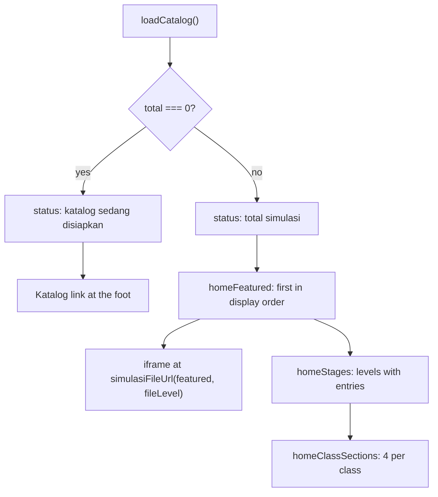

<details>
<summary>Relevant source files</summary>

The following files were used as context for generating or updating this documentation page:

- [`src/pages/index.astro`](../../src/pages/index.astro)
- [`src/lib/home.ts`](../../src/lib/home.ts)
- [`src/lib/katalogFilter.ts`](../../src/lib/katalogFilter.ts)
- [`src/lib/landing.ts`](../../src/lib/landing.ts)
- [`src/lib/tingkat.ts`](../../src/lib/tingkat.ts)
- [`src/lib/catalog.ts`](../../src/lib/catalog.ts)
- [`src/lib/loadCatalog.ts`](../../src/lib/loadCatalog.ts)
- [`src/layouts/Base.astro`](../../src/layouts/Base.astro)
- [`src/components/Icon.astro`](../../src/components/Icon.astro)
- [`test/home.test.ts`](../../test/home.test.ts)
- [`test/home-logic.test.ts`](../../test/home-logic.test.ts)
- [`test/landing-page.test.ts`](../../test/landing-page.test.ts)
- [`docs/adr/0010-site-keeps-its-own-dark-palette.md`](../../docs/adr/0010-site-keeps-its-own-dark-palette.md)
- [`docs/adr/0017-stitch-arcade-prototype-is-the-v1-design.md`](../../docs/adr/0017-stitch-arcade-prototype-is-the-v1-design.md)
</details>

# Home Page

The home page at `/` is the only page that opens with a live simulation. It opens with a hero on the left: an eyebrow label, a large uppercase heading, a short introduction, a button to the Katalog, and three stat cards counted from the catalogue (simulations, classes, subjects). The featured simulation is framed on the right. Below the hero come a link per school stage and a card grid per class. The look follows the Stitch arcade prototype (`docs/adr/0017`). See [Site Navigation](site-navigation.md) for the shared layout and [Katalog Page](katalog-page.md) for the full list.

Sources: [src/pages/index.astro:29-106](../../src/pages/index.astro), [src/pages/index.astro:160-176](../../src/pages/index.astro)

## Data

```astro
const catalog = await loadCatalog();
const featured = homeFeatured(catalog);
const classes = homeClassSections(catalog);
const stages = homeStages(catalog);
const total = catalog.length;
```

Sources: [src/pages/index.astro:13-18]()

This page calls `loadCatalog()` rather than `loadCatalogEntries()`, because the featured frame needs `fileLevel` to build the raw file URL.

Sources: [src/pages/index.astro:9-13](), [src/pages/index.astro:91-94]()

The stat cards are counted from the same data. The number of classes is the number of populated class sections, and the number of subjects is the number of distinct `subject` values.

Sources: [src/pages/index.astro:19-22](), [src/pages/index.astro:43-56]()

The Stitch prototype shows made-up figures for credits and streaks. The site has no accounts or scores, so those are left out.

Sources: [src/pages/index.astro:19-21](), [docs/adr/0017-stitch-arcade-prototype-is-the-v1-design.md](../../docs/adr/0017-stitch-arcade-prototype-is-the-v1-design.md)

## Hero

| Element | Content | Sources |
|---|---|---|
| Eyebrow | "Katalog simulasi", in a bordered `secondary` label | [src/pages/index.astro:32](), [src/pages/index.astro:178-189]() |
| Heading | "Pilih simulasi dan mulai belajar", uppercase by CSS | [src/pages/index.astro:33](), [src/pages/index.astro:191-199]() |
| Introduction | Two sentences on what a pupil does with a simulation | [src/pages/index.astro:35-39]() |
| Call to action | `Mulai belajar` plus `arrow-right` icon, linking to `/katalog/` | [src/pages/index.astro:41](), [src/pages/index.astro:219-237]() |
| Stat cards | Simulasi, Kelas, Mata pelajaran, each as a `stat` item | [src/pages/index.astro:43-56](), [src/pages/index.astro:239-256]() |
| Status line | Catalog count, or the "being prepared" message when empty | [src/pages/index.astro:58-70]() |
| Featured block | Heading "Mulai di sini", title link, class and subject, description | [src/pages/index.astro:72-85]() |

The call to action is styled as the arcade's coin button. The icon is drawn inline by `Icon.astro` and takes the button's text colour.

Sources: [src/pages/index.astro:219-237](), [src/components/Icon.astro:12-25]()

## Featured simulation

`homeFeatured` returns the first simulation in display order, or `null` when the catalog is empty so the page shows no frame rather than a broken one. A class works through the syllabus front to back, so the start is where a pupil begins and the page can say so plainly.

Sources: [src/lib/home.ts:9-19]()

```astro
            <iframe
              src={simulasiFileUrl(featured, featured.fileLevel)}
              title={featured.title}
            ></iframe>
```

Sources: [src/pages/index.astro:91-94]()

This iframe is simpler than the one on a [Halaman Simulasi](simulation-page.md): it carries no `id`, no `loading` and no `data-*` heights, and no script resizes it. Its height is whatever the frame's own CSS sets (`.bench-frame iframe`). The frame's edge is visible on purpose: the home page is built around the framed simulation, so a seam is the point of the layout.

Sources: [src/pages/index.astro:88-105](), [src/pages/index.astro:321-332](), [docs/adr/0010-site-keeps-its-own-dark-palette.md:5-13]()

A fallback link follows the frame, pointing at the same raw file in a new tab.

Sources: [src/pages/index.astro:95-102]()

The featured block renders only when `featured` is truthy, in both the text column and the frame column.

Sources: [src/pages/index.astro:72-73](), [src/pages/index.astro:88-89]()

The frame does not follow the header's light and dark choice: this page has no script, so the frame keeps the palette the simulation writes for itself (ADR 0023 gave every simulation both palettes, and the simulation then follows the system setting).

Sources: [src/pages/index.astro:88-105](), [src/layouts/Base.astro:38-45]()

## Stages

`homeStages` lists every stage holding at least one simulation, from primary upwards, with a count behind each link. A stage with nothing in it is absent rather than shown as empty, which is what keeps the home page from advertising four stages and delivering one.

Sources: [src/lib/home.ts:63-95]()

The stage block renders only when `stages.length > 0`, and ends with a link to the Katalog.

Sources: [src/pages/index.astro:108-126]()

## Class previews

`homeClassSections` returns every populated class in school order, each with its first `HOME_CLASS_PREVIEW_SIZE` (4) simulations and the path to the whole class. A preview is a way in rather than a wall.

Sources: [src/lib/home.ts:44-53](), [src/lib/home.ts:7](), [src/lib/home.ts:29-42]()

| Element | Content | Sources |
|---|---|---|
| Section heading | `section.label`, id `kelas-${key.replace('/', '-')}` | [src/pages/index.astro:130-131]() |
| Card title | Link to `simulasiUrl(entry)` | [src/pages/index.astro:135-137]() |
| Card description | `entry.description` | [src/pages/index.astro:139]() |
| Section footer | `Lihat {total} simulasi di {label}` linking to `section.path` | [src/pages/index.astro:143-145]() |

Each card is a `card` from the shared stylesheet in `Base.astro`, so it matches the Katalog and the class pages.

Sources: [src/pages/index.astro:132-134](), [src/layouts/Base.astro:321-327]()

## Empty catalog

The page answers an empty catalog rather than failing:

| Block | Condition | Sources |
|---|---|---|
| Status line | `total === 0` → "Katalog ini sedang disiapkan…" | [src/pages/index.astro:59-63]() |
| Status line | otherwise → "Saat ini ada {total} simulasi" | [src/pages/index.astro:64-68]() |
| Featured and frame blocks | `featured` is truthy | [src/pages/index.astro:73](), [src/pages/index.astro:89]() |
| Stages block | `stages.length > 0` | [src/pages/index.astro:109]() |
| Class sections | Always mapped; empty array renders nothing | [src/pages/index.astro:129]() |
| Katalog link | `total === 0` | [src/pages/index.astro:150-156]() |



Sources: [src/pages/index.astro:13-18](), [src/lib/home.ts:16-19](), [src/lib/home.ts:44-53](), [src/lib/home.ts:71-95]()

## Layout

The hero and the featured frame share a two-column grid: the text is 380px wide and the frame takes the rest. Below 760px the grid becomes one column, so the frame keeps the full width of a phone.

Sources: [src/pages/index.astro:160-176]()

## Ordering

Both `homeFeatured` and `homeClassSections` reuse `groupByKelas`, which owns display order. A second sort over the same data would be a second answer to a question that already has one.

Sources: [src/lib/home.ts:90-100](), [src/lib/katalogFilter.ts:159-196]()

## Testing

- [`test/home.test.ts`](../../test/home.test.ts)
- [`test/home-logic.test.ts`](../../test/home-logic.test.ts)
- [`test/landing-page.test.ts`](../../test/landing-page.test.ts)

## Known gaps

- The home page's featured frame is not resized by `src/lib/frame.ts`, unlike the frame on a Halaman Simulasi, and it does not follow the header's light and dark choice. Its height is whatever the page's own CSS sets. The source does not say whether the difference is deliberate.
  Sources: [src/pages/index.astro:88-105](), [src/lib/frame.ts:51-128]()

## Related pages

- [Simulation Page](simulation-page.md)
- [Site Navigation](site-navigation.md)
- [Landing Pages](landing-pages.md)
- [Site Theming](../development/theming.md)
