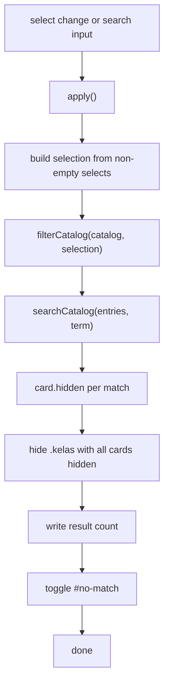

<details>
<summary>Relevant source files</summary>

The following files were used as context for generating or updating this documentation page:

- [`src/pages/katalog.astro`](../../src/pages/katalog.astro)
- [`src/lib/katalogFilter.ts`](../../src/lib/katalogFilter.ts)
- [`src/lib/landing.ts`](../../src/lib/landing.ts)
- [`src/lib/tingkat.ts`](../../src/lib/tingkat.ts)
- [`src/lib/catalog.ts`](../../src/lib/catalog.ts)
- [`src/lib/loadCatalog.ts`](../../src/lib/loadCatalog.ts)
- [`src/lib/types.ts`](../../src/lib/types.ts)
- [`src/layouts/Base.astro`](../../src/layouts/Base.astro)
- [`test/katalog.test.ts`](../../test/katalog.test.ts)
- [`test/katalogFilter.test.ts`](../../test/katalogFilter.test.ts)
- [`test/katalog-built.test.ts`](../../test/katalog.test.ts)
- [`CONTEXT.md`](../../CONTEXT.md)
</details>

# Katalog Page

The Katalog at `/katalog/` is the site's complete list of simulations, grouped into classes. Every simulation is present in the delivered HTML in display order; filtering and search only hide what is already there, so the page is fully readable with scripting unavailable. See [Catalog Model](../content/catalog-model.md) for the data behind it and [Landing Pages](landing-pages.md) for the addresses it also links to.

## Data

```astro
const catalog = await loadCatalogEntries();
const filterFields = buildFilterFields(catalog);
const cardAttributes = (entry: CatalogEntry) => ({
  'data-slug': entry.slug,
  'data-level': entry.level,
  'data-grade': String(entry.grade),
  'data-subject': entry.subject,
});
const groups = groupByKelas(catalog);
const landing = landingPages(catalog);
```

Sources: [src/pages/katalog.astro:15-36]()

Every simulation is in the HTML in display order, and the script below only hides what is already there. Display order is applied by `groupByKelas`, which owns it; sorting here as well would be a second pass over the same data that could disagree with it.

Sources: [src/pages/katalog.astro:10-15]()

The card carries the catalog fields as `data-*` attributes so filtering needs no fetch and no framework runtime. Title and description are deliberately *not* copied into attributes — the script reads them back out of the card text, so there is one copy of each rather than two that could drift.

Sources: [src/pages/katalog.astro:19-28](), [src/pages/katalog.astro:147-158]()

## Filters

Three filters are named, in the order a reader works through them: Tingkat, Kelas, Mata Pelajaran. The choices are built from whatever the catalog actually holds, so the site never offers a filter with nothing behind it and never needs a fixed list updated when content arrives.

Sources: [src/lib/katalogFilter.ts:26-35](), [src/lib/katalogFilter.ts:88-113]()

| Filter | Catalog field | Choice labels | Sort order |
|---|---|---|---|
| Tingkat | `level` | `tingkatLabel(value)` | School progression: sd, smp, sma, smk; unknown sorts last. |
| Kelas | `grade` | `Kelas {value}` | Ascending number. |
| Mata Pelajaran | `subject` | `subjectLabel(value)` | The label the reader sees, locale `id`. |

Sources: [src/lib/katalogFilter.ts:78-86](), [src/lib/katalogFilter.ts:101-112](), [src/lib/tingkat.ts:12-27]()

Kelas reads as a sequence of numbers and Tingkat reads in school order, which sorting the segments would get backwards (`sd`, `sma`, `smp`). Mata Pelajaran sorts by its visible label, so a mapping that renames a subject does not reorder the list away from its own wording.

Sources: [src/lib/katalogFilter.ts:101-110](), [src/lib/tingkat.ts:12-18]()

Four subjects are stored as lower-case URL segments but read as words: `ipa` → `IPA`, `pkn` → `PKn`, `pai` → `PAI`, `fik` → `FIK`. A subject not listed is still shown, capitalised as an ordinary word with hyphens read as word breaks, so the open set stays open.

Sources: [src/lib/katalogFilter.ts:44-66]()

## Client script

The script is guarded: if `#results`, `#no-match`, `#result-count` or `#filters` is missing, nothing happens.

Sources: [src/pages/katalog.astro:141-146]()

```ts
const apply = () => {
  const selection: { level?: string; grade?: number; subject?: string } = {};
  for (const select of selects) {
    if (select.value === '') continue;
    if (select.dataset.filter === 'grade') selection.grade = Number(select.value);
    else if (select.dataset.filter === 'level') selection.level = select.value;
    else if (select.dataset.filter === 'subject') selection.subject = select.value;
  }

  const term = searchBox?.value ?? '';
  const matches = new Set(
    searchCatalog(filterCatalog(catalog, selection), term).map((entry) => entry.slug),
  );
```

Sources: [src/pages/katalog.astro:163-175]()

Filters compose rather than override: choosing a Mata Pelajaran and a Kelas keeps simulations matching both, and contradictory choices simply match nothing.

Sources: [src/lib/katalogFilter.ts:115-129]()

An empty or whitespace-only search term is treated as no search, so clearing the box shows everything again rather than an empty list.

Sources: [src/lib/katalogFilter.ts:131-143]()

After matching, the script hides non-matching cards, hides any class section whose cards are all hidden, writes the count into a `role="status"` element, and toggles the no-match paragraph.

Sources: [src/pages/katalog.astro:177-194]()



Sources: [src/pages/katalog.astro:163-194]()

Listeners are attached for `change` on each select and `input` on the search box. The form's `submit` is prevented, because pressing Enter would otherwise reload the page and discard the search term and every chosen filter.

Sources: [src/pages/katalog.astro:196-202]()

## Structure

| Element | Condition | Sources |
|---|---|---|
| `<h1>Katalog Simulasi</h1>` | Always | [src/pages/katalog.astro:44]() |
| Filter form `#filters` | Always; hidden by `<noscript>` CSS when scripting is off | [src/pages/katalog.astro:52-75](), [src/pages/katalog.astro:206-214]() |
| Empty-catalog paragraph | `catalog.length === 0` | [src/pages/katalog.astro:78-82]() |
| `#results` with one `.kelas` section per class | `catalog.length > 0` | [src/pages/katalog.astro:84-104]() |
| Landing-page navigation | `landing.length > 0`, rendered *outside* `#results` | [src/pages/katalog.astro:110-126]() |
| `#no-match` | Hidden by default, shown by the script | [src/pages/katalog.astro:128-130]() |

The landing-page navigation sits outside the filtered region because these are pages rather than results: narrowing the list must not hide the way into them.

Sources: [src/pages/katalog.astro:108-109]()

Each card renders the title as a link to `simulasiUrl(entry)`, a meta line of `{tingkatLabel(level)} · Kelas {grade} · {subjectLabel(subject)}`, and the description.

Sources: [src/pages/katalog.astro:89-100](), [src/lib/catalog.ts:33]()

## Testing

- [`test/katalog.test.ts`](../../test/katalog.test.ts)
- [`test/katalogFilter.test.ts`](../../test/katalogFilter.test.ts)
- [`test/katalog-built.test.ts`](../../test/katalog.test.ts)

## Related pages

- [Catalog Model](../content/catalog-model.md)
- [Landing Pages](landing-pages.md)
- [Site Theming](../development/theming.md)
- [Simulation Page](simulation-page.md)
