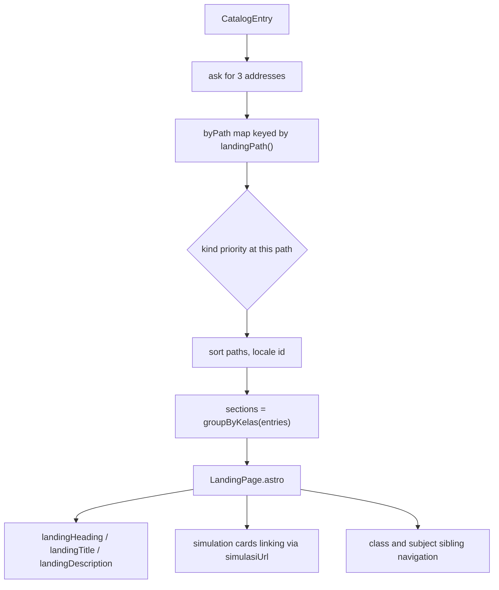

<details>
<summary>Relevant source files</summary>

The following files were used as context for generating or updating this documentation page:

- [`src/lib/landing.ts`](../../src/lib/landing.ts)
- [`src/components/LandingPage.astro`](../../src/components/LandingPage.astro)
- [`src/pages/[tingkat]/index.astro`](../../src/pages/[tingkat]/index.astro)
- [`src/pages/[tingkat]/[segmen]/index.astro`](../../src/pages/[tingkat]/[segmen]/index.astro)
- [`src/lib/katalogFilter.ts`](../../src/lib/katalogFilter.ts)
- [`src/lib/nav.ts`](../../src/lib/nav.ts)
- [`src/lib/tingkat.ts`](../../src/lib/tingkat.ts)
- [`src/lib/catalog.ts`](../../src/lib/catalog.ts)
- [`src/layouts/Base.astro`](../../src/layouts/Base.astro)
- [`test/nav.test.ts`](../../test/nav.test.ts)
- [`test/home.test.ts`](../../test/home.test.ts)
- [`docs/adr/0003-bahasa-url-path-segments.md`](../../docs/adr/0003-bahasa-url-path-segments.md)
</details>

# Landing Pages

A landing page is a headed list of simulations about one school stage, one class, or one subject. Which of the three it is decided entirely by its address. Nothing is listed in advance: a page exists because a catalog entry names the stage, class or subject it belongs to, so a subject nobody has thought of yet gets its page by being added as content.

Two dynamic routes generate every landing page, both delegating the whole body to [`src/components/LandingPage.astro`](../../src/components/LandingPage.astro). See [Catalog Model](../content/catalog-model.md) for the entries they read and [Katalog Page](katalog-page.md) for the links into them.

## Kinds and addresses

```ts
export type LandingKind = 'tingkat' | 'kelas' | 'mataPelajaran';
```

Sources: [src/lib/landing.ts:12]()

| Kind | Address | Example | Rendered by |
|---|---|---|---|
| `tingkat` | `/{level}/` | `/smp/` | [src/pages/[tingkat]/index.astro:17-22]() |
| `kelas` | `/{level}/kelas-{grade}/` | `/smp/kelas-7/` | [src/pages/[tingkat]/[segmen]/index.astro:16-20]() |
| `mataPelajaran` | `/{level}/{subject}/` | `/smp/matematika/` | [src/pages/[tingkat]/[segmen]/index.astro:16-20]() |

A stage's own page is one segment deep, because a reader who has bookmarked `/smp/` expects the stage there and not at `/smp/smp/`. A class and a subject sit under the stage, since both are taught within one. The trailing slash is required: the site builds with `trailingSlash: 'always'`.

Sources: [src/lib/landing.ts:36-48](), [astro.config.mjs:13-15]()

A subject page lives under a level because a subject is taught at more than one of them, and a reader looking for the SMP material should not have to guess which level it lives under from the subject name.

Sources: [src/lib/landing.ts:5-10]()

The second segment is named `segmen`, not `kelas`, because subject segments land on the same route.

Sources: [src/pages/[tingkat]/[segmen]/index.astro:5-12]()

## Collecting pages

```ts
for (const entry of entries) {
  collect('tingkat', entry.level, entry.level, entry);
  collect('kelas', entry.level, kelasSegment(entry.grade), entry);
  collect('mataPelajaran', entry.level, entry.subject, entry);
}
```

Sources: [src/lib/landing.ts:104-108]()

Each entry asks for up to three addresses, and entries are collected into a map keyed by path. The `kind` is recorded while collecting rather than guessed from the segment afterwards, because Mata Pelajaran is an open set and one may be named `kelas-9`; only this loop knows whether that address was asked for as a class or as a subject.

Sources: [src/lib/landing.ts:81-84](), [src/lib/landing.ts:96-103]()

A stage and a class sit at addresses the catalog composes, so a subject landing on one yields to it: `/smp/kelas-9/` has to keep meaning the class. The priority order is `mataPelajaran: 0`, `tingkat: 1`, `kelas: 2`, and the highest wins when two kinds ask for the same path.

Sources: [src/lib/landing.ts:86-94](), [src/lib/landing.ts:9-11]()

Pages are then sorted by path with locale `id`, and their simulations are grouped into sections by `groupByKelas`, so a page spanning more than one class reads in the same order the Katalog does.

Sources: [src/lib/landing.ts:113-129](), [src/lib/katalogFilter.ts:159-196]()

## Page shape

`LandingPage` carries `kind`, `level`, `segment`, `path`, and a list of `LandingSection`s. A section is always one Kelas: its `key` is `smp/kelas-7`, usable as an element id and unique within the page, and its `label` is the heading a reader sees.

Sources: [src/lib/landing.ts:14-34](), [src/lib/landing.ts:124-129]()



Sources: [src/lib/landing.ts:80-129](), [src/components/LandingPage.astro:31-129]()

## Headings, titles and descriptions

| Kind | `landingHeading` | `landingTitle` | `landingDescription` |
|---|---|---|---|
| `tingkat` | `tingkatLabel(level)` | `Simulasi {label} · Simula` | `{n} simulasi untuk tingkat {label}, disusun per kelas dan dapat langsung dibuka di peramban.` |
| `kelas` | `{label} — Kelas {n}` | `Simulasi {label} — Kelas {n} · Simula` | `{n} simulasi untuk {label} kelas {n}, disusun sesuai urutan materi dan dapat langsung dibuka di peramban.` |
| `mataPelajaran` | `{subject} untuk {label}` | `Simulasi {subject} untuk {label} · Simula` | `{n} simulasi mata pelajaran {subject} untuk {label}, disusun per kelas dan dapat langsung dibuka di peramban.` |

Sources: [src/lib/landing.ts:155-169](), [src/lib/landing.ts:173-186](), [src/lib/landing.ts:191-202]()

Headings are built from the page's own level and segment rather than read off its first section, so a heading survives a page whose simulations are all gone. Titles name what the page holds, because two of them can sit side by side in search results.

Sources: [src/lib/landing.ts:150-154](), [src/lib/landing.ts:167-172]()

## Component structure

`LandingPage.astro` takes `page` and `siblings` — every landing page at the same stage, this one included.

Sources: [src/components/LandingPage.astro:9-13]()

It derives `kelasSiblings` and `subjectSiblings` by filtering on `kind`, and builds a sheet link only for a class page.

Sources: [src/components/LandingPage.astro:17-18](), [src/components/LandingPage.astro:28]()

| Block | Condition | Sources |
|---|---|---|
| `<Base>` with `landingTitle` / `landingDescription`, no `noindex` | Always | [src/components/LandingPage.astro:31]() |
| Breadcrumb | Ternary on `kind === 'tingkat'` | [src/components/LandingPage.astro:36-47]() |
| Link to the class sheet | `sheetHref` non-null, i.e. a class page | [src/components/LandingPage.astro:49-57]() |
| Simulation sections | Always | [src/components/LandingPage.astro:60-87]() |
| Class sibling navigation | `kind === 'tingkat' \|\| kelasSiblings.length > 0` | [src/components/LandingPage.astro:88-112]() |
| Subject sibling navigation | `subjectSiblings.length > 0` | [src/components/LandingPage.astro:114-127]() |

Heading levels follow the page kind: a class page's card headings are `h2`, and a stage or subject page puts the class heading at `h2` with card headings at `h3`.

Sources: [src/components/LandingPage.astro:65-72]()

The page heading uses the display face in uppercase (`h1` in the component's own style). The simulation cards carry no style of their own: they use the shared `.card` from the layout, so they match the home page and the Katalog.

Sources: [src/components/LandingPage.astro:142-149](), [src/layouts/Base.astro:321-327]()

The sheet link is built in the component, not in the route, so the route stays a pure delegation.

Sources: [src/components/LandingPage.astro:28](), [src/lib/sheet.ts:53-56]()

## Navigation

The site navigation is built from the same landing pages, so a new stage, class or subject reaches it by being added as content. An empty catalog yields only the two pages that always exist — Beranda and Katalog — because a link to a page that lists nothing is worse than no link.

Sources: [src/lib/nav.ts:15-21](), [src/lib/nav.ts:27-33]()

Links read stage by stage in school order, and within a stage list the stage itself, then its classes, then its subjects. Sorting by address instead would interleave the two, since every subject segment happens to sort before `kelas-`.

Sources: [src/lib/nav.ts:35-46]()

A link is marked current only when its path equals the current pathname with a trailing slash on both sides, so a reader who arrived without one is still recognised.

Sources: [src/lib/nav.ts:53-60](), [src/layouts/Base.astro:71-75]()

## Looking a page up

`landingPageAt(entries, level, segment)` returns the page at one address, or nothing when the catalog holds no such page. The route is dynamic, so it is asked about every address it generated; a segment the catalog does not contain returns nothing rather than publishing a page that lists nothing.

Sources: [src/lib/landing.ts:136-150]()

## Related pages

- [Catalog Model](../content/catalog-model.md)
- [Katalog Page](katalog-page.md)
- [Printable Class Sheet](printable-class-sheet.md)
- [Site Navigation](site-navigation.md)
- [Simulation Page](simulation-page.md)
