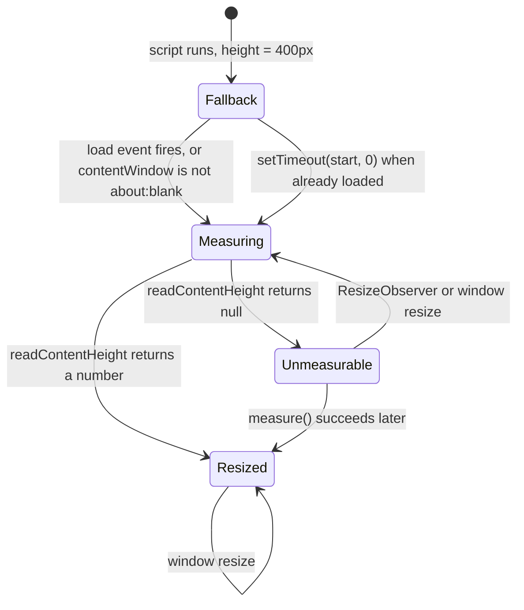

<details>
<summary>Relevant source files</summary>

The following files were used as context for generating or updating this documentation page:

- [`src/pages/[tingkat]/[kelas]/[mataPelajaran]/[slug].astro`](../../src/pages/[tingkat]/[kelas]/[mataPelajaran]/[slug].astro)
- [`src/lib/frame.ts`](../../src/lib/frame.ts)
- [`src/lib/catalog.ts`](../../src/lib/catalog.ts)
- [`src/lib/related.ts`](../../src/lib/related.ts)
- [`src/lib/loadCatalog.ts`](../../src/lib/loadCatalog.ts)
- [`src/layouts/Base.astro`](../../src/layouts/Base.astro)
- [`src/lib/katalogFilter.ts`](../../src/lib/katalogFilter.ts)
- [`test/frame-height.test.ts`](../../test/frame-height.test.ts)
- [`test/frame-page.test.ts`](../../test/frame-page.test.ts)
- [`test/halaman-simulasi.test.ts`](../../test/halaman-simulasi.test.ts)
- [`docs/adr/0005-embed-simulations-in-iframe.md`](../../docs/adr/0005-embed-simulations-in-iframe.md)
- [`docs/adr/0007-replacement-keeps-the-url.md`](../../docs/adr/0007-replacement-keeps-the-url.md)
</details>

# Simulation Page (Halaman Simulasi)

The Halaman Simulasi is the generated page that wraps one simulation: its Bahasa Indonesia title, description, level, class and subject, plus a frame holding the simulation itself. It is the only page on the site with a client-side script, and the only one that reads outside the same document.

Every Halaman Simulasi is produced by one dynamic route, [`src/pages/[tingkat]/[kelas]/[mataPelajaran]/[slug].astro`](../../src/pages/[tingkat]/[kelas]/[mataPelajaran]/[slug].astro), with one path per catalog entry. Simulations are framed in an `iframe` rather than linked, so the pupil keeps the site's navigation and back button intact ([docs/adr/0005](../../docs/adr/0005-embed-simulations-in-iframe.md)). See [Catalog Model](../content/catalog-model.md) for how entries are read and validated.

## Route generation

```astro
export const getStaticPaths = (async () => {
  const catalog = await loadCatalog();

  return catalog.map((entry) => ({
    params: simulasiUrlSegments(entry),
    props: { entry },
  }));
}) satisfies GetStaticPaths;
```

Sources: [src/pages/[tingkat]/[kelas]/[mataPelajaran]/[slug].astro:14-21]()

Both the route params and the page's own URL are composed by `simulasiUrlSegments`, so the page and the catalog cannot disagree about where a simulation lives.

Sources: [src/pages/[tingkat]/[kelas]/[mataPelajaran]/[slug].astro:11-18](), [src/lib/catalog.ts:11-22](), [docs/adr/0003-bahasa-url-path-segments.md:1-3]()

This route calls `loadCatalog()` rather than `loadCatalogEntries()`, because it needs `entry.fileLevel`.

Sources: [src/pages/[tingkat]/[kelas]/[mataPelajaran]/[slug].astro:15](), [src/pages/[tingkat]/[kelas]/[mataPelajaran]/[slug].astro:27](), [src/lib/loadCatalog.ts:27-30]()

## The frame

```astro
      <iframe
        id={FRAME_ID}
        src={rawFileUrl}
        title={entry.title}
        loading="lazy"
        data-fallback-height={String(FALLBACK_HEIGHT)}
        data-unmeasurable-height={String(UNMEASURABLE_HEIGHT)}
      ></iframe>
```

Sources: [src/pages/[tingkat]/[kelas]/[mataPelajaran]/[slug].astro:73-80]()

| Attribute | Value | Note |
|---|---|---|
| `id` | `simulation-frame` | Shared constant, so the script has no hardcoded path. |
| `src` | `/simulasi/${entry.fileLevel}/${entry.slug}.html` | Built from the *file's* level, not the entry's. |
| `title` | `entry.title` | Names the frame for assistive technology. |
| `loading` | `lazy` | |
| `data-fallback-height` | `400` | `FALLBACK_HEIGHT`. |
| `data-unmeasurable-height` | `1600` | `UNMEASURABLE_HEIGHT`. |
| `sandbox` | Not present | |
| `allow` | Not present | |

Sources: [src/pages/[tingkat]/[kelas]/[mataPelajaran]/[slug].astro:73-80](), [src/lib/frame.ts:21](), [src/lib/frame.ts:30](), [src/lib/frame.ts:33-35](), [src/lib/catalog.ts:43-45]()

The `src` deliberately uses `entry.fileLevel`. `simulasiFileUrl` takes the level as a parameter instead of reading it off the catalog entry, because the build hook writes each file under the level its source folder implies; deriving the path from the entry would let a level disagreement — only a warning — publish a page whose simulation 404s.

Sources: [src/pages/[tingkat]/[kelas]/[mataPelajaran]/[slug].astro:24-27](), [src/lib/catalog.ts:35-45](), [src/lib/loadCatalog.ts:18-26]()

A text fallback link follows the frame, so a reader whose browser blocks the frame can still open the raw file in a new tab.

Sources: [src/pages/[tingkat]/[kelas]/[mataPelajaran]/[slug].astro:82-85]()

## Frame sizing

A simulation's height is not knowable at build time: measured across the simulations then in the repo, content height ranged from 670px to 1911px at the same viewport, and moved by up to 578px within one simulation as the window narrowed.

Sources: [src/lib/frame.ts:1-13]()

The client script reads the rendered bounds of the child's own elements and never the child's reported scroll height, because a frame given a height makes the document inside it report exactly that height — the reading would be circular.

Sources: [src/lib/frame.ts:12-15](), [src/lib/frame.ts:186-196]()

```ts
const frame = document.getElementById(FRAME_ID) as HTMLIFrameElement | null;
if (frame) {
  attachFrameResize(frame, {
    fallbackHeight: Number(frame.dataset.fallbackHeight),
    unmeasurableHeight: Number(frame.dataset.unmeasurableHeight),
  });
}
```

Sources: [src/pages/[tingkat]/[kelas]/[mataPelajaran]/[slug].astro:105-117]()

The script only grows the frame. The simulation is shown either way, so a reader without scripting sees a frame at its fallback height rather than a blank page.

Sources: [src/pages/[tingkat]/[kelas]/[mataPelajaran]/[slug].astro:108-110]()

### Measurement lifecycle



Sources: [src/lib/frame.ts:51-128]()

Three ordering details matter, and each fixes a real failure:

- **The fallback height is set before the load listener is registered.** A frame that already loaded measures straight away, and would otherwise be reset to 400px afterwards — a page that looks stuck at 400px for content that is 800px tall.
  Sources: [src/lib/frame.ts:102-112]()
- **The load listener is registered unconditionally.** A frame whose document already reports itself complete is the empty `about:blank` it was born with, not the simulation.
  Sources: [src/lib/frame.ts:109-112]()
- **A frame that finished loading before the script ran gets a `setTimeout(start, 0)`.** Measured on the real page, such a frame sat at its 400px fallback with `data-measured` unset on roughly one load in eight. The guard uses `contentWindow` and compares `document.location.href` to `about:blank`, not `readyState`, because a newborn frame reports itself complete.
  Sources: [src/lib/frame.ts:114-128]()

`contentHeight` is a pure function of the boxes handed to it, and never reads the frame's own height back — otherwise the frame would be set to the frame, and each measurement would return the previous answer a little larger. That fault was measured: one simulation reported 1116px for 821px of content.

Sources: [src/lib/frame.ts:130-172](), [src/lib/frame.ts:174-183]()

`position: fixed` elements are skipped, because they are sized to the viewport and counting one would make the frame as tall as the window. The frame's scroll position is added back, because bounds are viewport-relative — without it, scrolling a simulation would shrink the frame by the distance scrolled and cut off the bottom of what the reader was reading.

Sources: [src/lib/frame.ts:166-183]()

Nothing here touches the simulation files. A library such as `@iframe-resizer` would need a script injected into the child, which this project never does.

Sources: [src/lib/frame.ts:16-18](), [docs/adr/0005-embed-simulations-in-iframe.md:82-90]()

## Related simulations

```astro
<nav class="related" aria-labelledby="related-heading">
  <h2 id="related-heading">Simulasi lain di {subjectLabel(entry.subject)}</h2>
  <ul>
    {related.map((item) => (
      <li><a href={simulasiUrl(item)}>{item.title}</a></li>
    ))}
  </ul>
</nav>
```

Sources: [src/pages/[tingkat]/[kelas]/[mataPelajaran]/[slug].astro:87-100]()

`relatedSimulations` walks outward from the current simulation's position in display order within its own class — the next one, then the one before, then the one after that — up to `RELATED_COUNT` (5). Any remaining places are filled with the same subject at another level, never with a different subject, which would not be usable in this class. A subject with nothing else in it yields a short list rather than a padded one.

Sources: [src/lib/related.ts:1-25](), [src/lib/related.ts:57-68]()

Suggestions come from the same catalog the page was generated from, so a neighbour linked here is a page the build actually produced. The current simulation stays in the list it is matched against, since its position is what the walk starts from.

Sources: [src/pages/[tingkat]/[kelas]/[mataPelajaran]/[slug].astro:29-33](), [src/lib/related.ts:37-47]()

The section renders only when `related.length > 0`.

Sources: [src/pages/[tingkat]/[kelas]/[mataPelajaran]/[slug].astro:88]()

## Page structure

| Element | Content | Sources |
|---|---|---|
| `<Base>` | `title={`${entry.title} · Simula`}`, `description={entry.description}`, no `noindex` — this page is indexable. | [src/pages/[tingkat]/[kelas]/[mataPelajaran]/[slug].astro:49](), [src/layouts/Base.astro:36-39]() |
| Breadcrumb | Beranda → Katalog → Tingkat → Kelas, with the subject as `aria-current="page"`. | [src/pages/[tingkat]/[kelas]/[mataPelajaran]/[slug].astro:38-46](), [src/pages/[tingkat]/[kelas]/[mataPelajaran]/[slug].astro:52-63]() |
| `<h1>` | `entry.title` | [src/pages/[tingkat]/[kelas]/[mataPelajaran]/[slug].astro:66]() |
| Description | `entry.description`, in the information column beside the frame (below the frame under 1200px) | [src/pages/[tingkat]/[kelas]/[mataPelajaran]/[slug].astro:89-95]() |
| Meta line | `{tingkatLabel(entry.level)} · Kelas {entry.grade} · {subjectLabel(entry.subject)}` | [src/pages/[tingkat]/[kelas]/[mataPelajaran]/[slug].astro:68-70]() |

The breadcrumb walks the same segments the URL does, so it names the stage, class and subject a reader arrived through.

The frame and its new-tab link sit in a `.stage` column. The information column (`.side`) holds the description and the related simulations. On a screen 1200px wide or more the two sit side by side at two fifths and one fifth of the width; below that they stack. The document order is unchanged, so tab order still reaches the breadcrumb before the frame and the new-tab link after it (`docs/adr/0018`).

Sources: [src/pages/[tingkat]/[kelas]/[mataPelajaran]/[slug].astro:35-46]()

## Testing

Three test files cover this page and the frame arithmetic:

- [`test/halaman-simulasi.test.ts`](../../test/halaman-simulasi.test.ts)
- [`test/frame-page.test.ts`](../../test/frame-page.test.ts)
- [`test/frame-height.test.ts`](../../test/frame-height.test.ts)

## Known gaps

- The iframe carries no `sandbox` attribute and no `allow` attribute; neither appears anywhere in the page. Same-origin embedding is what the frame measurement relies on.
  Sources: [src/pages/[tingkat]/[kelas]/[mataPelajaran]/[slug].astro:73-80](), [src/lib/frame.ts:82-94]()
- The measurement range quoted in `src/lib/frame.ts:1-13` was taken across 23 simulations; the repository now holds 71.

## Related pages

- [Catalog Model](../content/catalog-model.md)
- [Landing Pages](landing-pages.md)
- [Site Theming](../development/theming.md)
- [Cloudflare Deployment](../deployment/cloudflare-worker.md)
