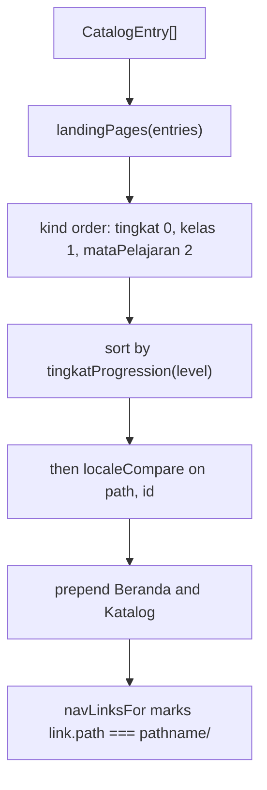

<details>
<summary>Relevant source files</summary>

The following files were used as context for generating or updating this documentation page:

- [`src/layouts/Base.astro`](../../src/layouts/Base.astro)
- [`src/lib/nav.ts`](../../src/lib/nav.ts)
- [`src/lib/landing.ts`](../../src/lib/landing.ts)
- [`src/lib/tingkat.ts`](../../src/lib/tingkat.ts)
- [`src/lib/loadCatalog.ts`](../../src/lib/loadCatalog.ts)
- [`src/lib/theme.ts`](../../src/lib/theme.ts)
- [`src/pages/katalog.astro`](../../src/pages/katalog.astro)
- [`test/nav.test.ts`](../../test/nav.test.ts)
- [`test/nav-built.test.ts`](../../test/nav-built.test.ts)
- [`test/chrome-built.test.ts`](../../test/chrome-built.test.ts)
</details>

# Site Navigation and Layout

Every page on the site renders through [`src/layouts/Base.astro`](../../src/layouts/Base.astro), which owns the document head, the site navigation and the global palette. The navigation itself is built from the Katalog rather than written out, so a new stage, class or subject reaches it by being added as content. See [Architecture Overview](../architecture/overview.md) for the shape of the whole site.

The header is an arcade bar: the site name on the left and subject tabs on the right. The current tab is filled with the accent colour. On a phone the tabs become one row that scrolls sideways, so the header stays short (`docs/adr/0017`).

## Layout props

```ts
interface Props {
  title: string;
  description: string;
  /** Set on a page that must never be indexed, such as a raw simulation file. */
  noindex?: boolean;
}

const { title, description, noindex = false } = Astro.props;
const canonical = new URL(Astro.url.pathname, Astro.site);
```

Sources: [src/layouts/Base.astro:6-14]()

## Document head

| Element | Source | Notes |
|---|---|---|
| `<html lang="id">` | Static | The whole site is Bahasa Indonesia. |
| `<meta charset>`, `<meta name="viewport">` | Static | |
| `<style set:html={themeCustomProperties()}>` | `src/lib/theme.ts` | Emits the palette as CSS custom properties. |
| `<title>{title}</title>` | Prop | |
| `<meta name="description">` | Prop | |
| `<link rel="canonical">` | `Astro.url.pathname` + `Astro.site` | |
| `<meta name="robots" content="noindex">` | `noindex && …` | |

Sources: [src/layouts/Base.astro:24-39](), [src/lib/theme.ts:88-99]()

There are no `og:` or `twitter:` meta tags and no JSON-LD anywhere in the layout or pages.

Sources: [src/layouts/Base.astro:24-40]()

The palette goes through `set:html` rather than into an Astro `<style>` block: a `<style>` block is not a template expression site, so a `{call()}` in one is not evaluated, reaches the CSS minifier as literal text, and fails the build with `Invalid empty selector`.

Sources: [src/layouts/Base.astro:29-35]()

Only the printable sheet passes `noindex={true}`; `Base.astro:39` is the only place the prop becomes a meta tag.

Sources: [src/components/Sheet.astro:28](), [src/layouts/Base.astro:39]()

## The navigation bar

```astro
    <nav class="site-nav" aria-label="Navigasi utama">
      <p class="site-name"><a href="/">Simula</a></p>
      <ul>
        {
          navLinks.map((link) => (
            <li>
              <a href={link.path} aria-current={link.current ? 'page' : undefined}>
                {link.label}
              </a>
            </li>
          ))
        }
      </ul>
    </nav>
```

Sources: [src/layouts/Base.astro:42-55]()

The catalog is read again per page rather than cached: Astro already holds the content collection for the build, and a cache here would only add a path that cannot be exercised by a test.

Sources: [src/layouts/Base.astro:16-21]()

## Building the links

```ts
const ALWAYS: { path: string; label: string }[] = [
  { path: '/', label: 'Beranda' },
  { path: '/katalog/', label: 'Katalog' },
];
```

Sources: [src/lib/nav.ts:21-24]()

The Katalog is here even before anything is published: it is where a reader goes to find out what exists, so a site with nothing in it still answers.

Sources: [src/lib/nav.ts:15-20]()

`siteLinksFor` builds the rest from `landingPages(entries)` and returns `[...ALWAYS, ...landing]` with `current` set to `false` everywhere. An empty catalog yields only the two pages that always exist, because a link to a page that lists nothing is worse than no link.

Sources: [src/lib/nav.ts:34-56](), [src/lib/nav.ts:27-33]()



Sources: [src/lib/nav.ts:34-63]()

Links read stage by stage in school order, and within a stage list the stage itself, then its classes, then its subjects. Sorting by address instead would interleave the two, since every subject segment happens to sort before `kelas-`.

Sources: [src/lib/nav.ts:37-46]()

`tingkatProgression` orders stages from primary upwards — `sd` 0, `smp` 1, `sma` 2, `smk` 3 — because sorting the URL segments would put `sma` before `smp`, which reads backwards. An unknown segment sorts last rather than being dropped, keeping a newly added stage at the end.

Sources: [src/lib/tingkat.ts:12-18](), [src/lib/tingkat.ts:25-27]()

`navLinksFor` compares with a trailing slash put on both sides, so a reader who arrived without one is still recognised rather than every link reading as unvisited while the page itself is the current one.

Sources: [src/lib/nav.ts:61-69]()

Link labels come from `landingHeading`, so the navigation shows `Sekolah Dasar`, `SMP — Kelas 7` and `Matematika untuk SMP` rather than bare URL segments.

Sources: [src/lib/landing.ts:155-169](), [src/lib/tingkat.ts:33-35]()

## Global styles

The `<style is:global>` block paints `html` with `var(--bg)` and `var(--text)`, so no page repeats a palette value. The print sheet overrides these under `@media print`.

Sources: [src/layouts/Base.astro:60-63](), [src/components/Sheet.astro:158-162](), [src/lib/theme.ts:88-99]()

## Testing

- [`test/nav.test.ts`](../../test/nav.test.ts)
- [`test/nav-built.test.ts`](../../test/nav-built.test.ts)
- [`test/chrome-built.test.ts`](../../test/chrome-built.test.ts)

## Related pages

- [Site Theming](../development/theming.md)
- [Landing Pages](landing-pages.md)
- [Katalog Page](katalog-page.md)
- [Home Page](home-page.md)
