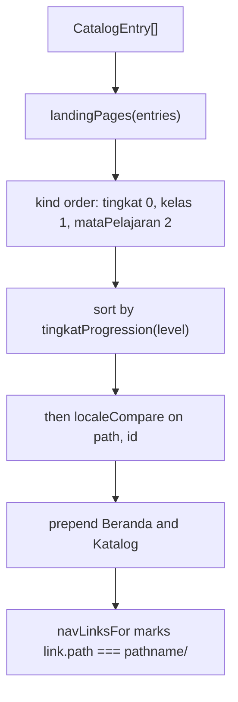

<details>
<summary>Relevant source files</summary>

The following files were used as context for generating or updating this documentation page:

- [`src/layouts/Base.astro`](../../src/layouts/Base.astro)
- [`src/components/Icon.astro`](../../src/components/Icon.astro)
- [`src/lib/icons.ts`](../../src/lib/icons.ts)
- [`src/lib/nav.ts`](../../src/lib/nav.ts)
- [`src/lib/landing.ts`](../../src/lib/landing.ts)
- [`src/lib/tingkat.ts`](../../src/lib/tingkat.ts)
- [`src/lib/loadCatalog.ts`](../../src/lib/loadCatalog.ts)
- [`src/lib/theme.ts`](../../src/lib/theme.ts)
- [`src/pages/katalog.astro`](../../src/pages/katalog.astro)
- [`public/favicon.svg`](../../public/favicon.svg)
- [`test/nav.test.ts`](../../test/nav.test.ts)
- [`test/nav-built.test.ts`](../../test/nav-built.test.ts)
- [`test/chrome-built.test.ts`](../../test/chrome-built.test.ts)
- [`docs/adr/0022-icons-are-lucide-inline-svg.md`](../../docs/adr/0022-icons-are-lucide-inline-svg.md)
</details>

# Site Navigation and Layout

Every page on the site renders through [`src/layouts/Base.astro`](../../src/layouts/Base.astro), which owns the document head, the site navigation, the global palette and the header's light and dark switch. The navigation itself is built from the Katalog rather than written out, so a new stage, class or subject reaches it by being added as content. See [Architecture Overview](../architecture/overview.md) for the shape of the whole site.

The header is an arcade bar: the Simula name with its logo on the left, subject tabs in the middle, and the mode switch on the right. The current tab is filled with the accent colour. The switch chooses between the light and dark palettes. The choice is stored, and without one the page is dark, whatever the system asks for (`docs/adr/0017`, `docs/adr/0019`, `docs/adr/0025`). On a phone the tabs become one row that scrolls sideways, and the switch wraps to a second row, because the tab list takes the full width.

Sources: [src/layouts/Base.astro:56-85](../../src/layouts/Base.astro), [src/layouts/Base.astro:189-200](../../src/layouts/Base.astro), [src/layouts/Base.astro:291-308](../../src/layouts/Base.astro)

## Layout props

```ts
interface Props {
  title: string;
  description: string;
  /** Set on a page that must never be indexed, such as a raw simulation file. */
  noindex?: boolean;
}

const { title, description, noindex = false } = Astro.props;
const canonical = new URL(Astro.url.pathname, Astro.site);
```

Sources: [src/layouts/Base.astro:7-15](../../src/layouts/Base.astro)

## Document head

| Element | Source | Notes |
|---|---|---|
| `<html lang="id">` | Static | The whole site is Bahasa Indonesia. |
| `<meta charset>`, `<meta name="viewport">` | Static | |
| `<style set:html={themeStylesheet()}>` | `src/lib/theme.ts` | Emits the dark palette as the default and the light palette under `data-theme`. |
| Inline `<script>` | Static | Reads `localStorage` key `theme` and sets `data-theme` before first paint: `light` if stored, otherwise `dark` (ADR 0025). |
| `<link rel="stylesheet" href="/fonts/fonts.css">` | `public/fonts/` | Self-hosted fonts. |
| `<link rel="icon">` (`.ico` 32px, `.svg`), `<link rel="apple-touch-icon">` | `public/` | The favicon set. |
| `<title>{title}</title>` | Prop | |
| `<meta name="description">` | Prop | |
| `<link rel="canonical">` | `Astro.url.pathname` + `Astro.site` | |
| `<meta name="robots" content="noindex">` | `noindex && …` | |

Sources: [src/layouts/Base.astro:25-54](../../src/layouts/Base.astro), [src/lib/theme.ts:140-151](../../src/lib/theme.ts), [public/favicon.svg](../../public/favicon.svg)

The palette goes through `set:html` rather than into an Astro `<style>` block: a `<style>` block is not a template expression site, so a `{call()}` in one is not evaluated, reaches the CSS minifier as literal text, and fails the build with `Invalid empty selector`.

Sources: [src/layouts/Base.astro:30-36](../../src/layouts/Base.astro)

Only the printable sheet passes `noindex={true}`; `Base.astro:53` is the only place the prop becomes a meta tag.

Sources: [src/components/Sheet.astro:28](../../src/components/Sheet.astro), [src/layouts/Base.astro:53](../../src/layouts/Base.astro)

There are no `og:` or `twitter:` meta tags and no JSON-LD in the layout.

Sources: [src/layouts/Base.astro:25-54](../../src/layouts/Base.astro)

## The navigation bar

```astro
    <nav class="site-nav" aria-label="Navigasi utama">
      <p class="site-name">
        <a href="/">
          <svg class="brand-mark" viewBox="0 0 24 24" ... aria-hidden="true" focusable="false">
            <path d="M2 16H22" />
            <path d="M5 14V18" />
            <path d="M12 14V18" />
            <path d="M5 11.5C5 4 19 4 19 11.5" />
            <circle cx="19" cy="16" r="2.5" stroke="none" style="fill: var(--secondary)" />
          </svg>
          Simula
        </a>
      </p>
      <ul>
        {
          navLinks.map((link) => (
            <li>
              <a href={link.path} aria-current={link.current ? 'page' : undefined}>
                {link.label}
              </a>
            </li>
          ))
        }
      </ul>
      <button type="button" id="theme-toggle" class="theme-toggle">
        <span id="theme-icon-light"><Icon name="flashlight" /></span>
        <span id="theme-icon-dark" hidden><Icon name="flashlight-off" /></span>
        <span id="theme-label">Mode terang</span>
      </button>
    </nav>
```

Sources: [src/layouts/Base.astro:56-85]() (the `svg` attributes are shortened here; the full element is on line 59)

The logo is drawn as line art in `currentColor`, with its dot in the `secondary` token, so the dot changes with the palette. It is decorative: `aria-hidden` hides it, and the name next to it is the link text.

Sources: [src/layouts/Base.astro:59-66](../../src/layouts/Base.astro)

The catalog is read again per page rather than cached: Astro already holds the content collection for the build, and a cache here would only add a path that cannot be exercised by a test.

Sources: [src/layouts/Base.astro:17-21](../../src/layouts/Base.astro)

## The mode switch

The button is built from two flashlight icons and a label. Only one icon is shown at a time, and the label names the mode the button will switch to.

Sources: [src/layouts/Base.astro:80-84](../../src/layouts/Base.astro)

```ts
const showTarget = (target: 'light' | 'dark') => {
  label.textContent = target === 'light' ? 'Mode terang' : 'Mode gelap';
  lightIcon.hidden = target !== 'light';
  darkIcon.hidden = target !== 'dark';
};
```

Sources: [src/layouts/Base.astro:96-100]()

A click writes the new choice to `data-theme` on `<html>` and to `localStorage`. Storage can be blocked, in which case the choice lasts for the page only.

Sources: [src/layouts/Base.astro:102-111]()

## Icons

Icons are inline SVG. The paths live in `src/lib/icons.ts`, copied from the Lucide set under the ISC licence, and `Icon.astro` draws one by name. The site never loads icons from another host (`docs/adr/0022`).

```ts
export const ICONS = {
  play: '<path d="M5 5a2 2 0 0 1 3.008-1.728l11.997 6.998a2 2 0 0 1 .003 3.458l-12 7A2 2 0 0 1 5 19z" />',
  'rotate-ccw': '<path d="M3 12a9 9 0 1 0 9-9 9.75 9.75 0 0 0-6.74 2.74L3 8" /><path d="M3 3v5h5" />',
  'arrow-right': '<path d="M5 12h14" /><path d="m12 5 7 7-7 7" />',
  flashlight: '…',
  'flashlight-off': '…',
  'external-link': '…',
} as const;
```

Sources: [src/lib/icons.ts:1-16]()

Six icons are defined. `play` and `rotate-ccw` are the start and reset icons; they are written inline into the simulation files that have those buttons (27 files contain `play`), not imported from this map. The others are `arrow-right` (the home page's call to action), `external-link` (the fallback link on a simulation page), and the two flashlights (the mode switch). An icon the site uses needs its path added here first.

Sources: [src/lib/icons.ts:6-16](../../src/lib/icons.ts), [src/pages/index.astro:41](../../src/pages/index.astro), [src/pages/[tingkat]/[kelas]/[mataPelajaran]/[slug].astro:89](../../src/pages/[tingkat]/[kelas]/[mataPelajaran]/[slug].astro)

`Icon.astro` renders an empty `<svg>` with `set:html` for the paths, `width` and `height` of `1em`, `stroke="currentColor"`, and `aria-hidden="true"`. The icon therefore takes the text colour and size of the text beside it. The label is always text, so an icon never carries meaning by itself.

Sources: [src/components/Icon.astro:12-25](../../src/components/Icon.astro), [src/components/Icon.astro:27-33](../../src/components/Icon.astro)

## Building the links

```ts
const ALWAYS: { path: string; label: string }[] = [
  { path: '/', label: 'Beranda' },
  { path: '/katalog/', label: 'Katalog' },
];
```

Sources: [src/lib/nav.ts:21-24]()

The Katalog is here even before anything is published: it is where a reader goes to find out what exists, so a site with nothing in it still answers.

Sources: [src/lib/nav.ts:15-20]()

`siteLinksFor` builds the rest from `landingPages(entries)` and returns `[...ALWAYS, ...landing]` with `current` set to `false` everywhere. An empty catalog yields only the two pages that always exist, because a link to a page that lists nothing is worse than no link.

Sources: [src/lib/nav.ts:34-56](), [src/lib/nav.ts:27-33]()



Sources: [src/lib/nav.ts:34-63]()

Links read stage by stage in school order, and within a stage list the stage itself, then its classes, then its subjects. Sorting by address instead would interleave the two, since every subject segment happens to sort before `kelas-`.

Sources: [src/lib/nav.ts:37-46]()

`tingkatProgression` orders stages from primary upwards — `sd` 0, `smp` 1, `sma` 2, `smk` 3 — because sorting the URL segments would put `sma` before `smp`, which reads backwards. An unknown segment sorts last rather than being dropped, keeping a newly added stage at the end.

Sources: [src/lib/tingkat.ts:12-18](), [src/lib/tingkat.ts:25-27]()

`navLinksFor` compares with a trailing slash put on both sides, so a reader who arrived without one is still recognised rather than every link reading as unvisited while the page itself is the current one.

Sources: [src/lib/nav.ts:61-69]()

Link labels come from `landingHeading`, so the navigation shows `Sekolah Dasar`, `SMP — Kelas 7` and `Matematika untuk SMP` rather than bare URL segments.

Sources: [src/lib/landing.ts:155-169](), [src/lib/tingkat.ts:33-35]()

## Global styles

The `<style is:global>` block paints `html` with `var(--bg)` and `var(--text)`, so no page repeats a palette value. It also declares the three font roles (`--font-display`, `--font-body`, `--font-mono`), the link colours, and one focus ring for every control.

Sources: [src/layouts/Base.astro:116-131](../../src/layouts/Base.astro), [src/layouts/Base.astro:145-178](../../src/layouts/Base.astro)

The header and the switch are styled from the same tokens as the rest of the site. The current tab uses `accent` with `accent-text`, and hovering a tab or the switch turns its outline to `secondary`.

Sources: [src/layouts/Base.astro:189-287](../../src/layouts/Base.astro)

The card style is declared once here as `.cards` and `.card`, so the home page, the Katalog and the class pages draw a card the same way. Each card has a lit accent edge along its top.

Sources: [src/layouts/Base.astro:310-368](../../src/layouts/Base.astro)

The print sheet overrides the global styles under `@media print`.

Sources: [src/components/Sheet.astro:158-162](../../src/components/Sheet.astro)

## The footer

Every page ends with a footer below its content (ADR 0024). It uses the header's bar style, mirrored to the bottom edge, with a border on its top edge.

- The left side is the release, `v1.0.0`, in a bordered tag. It is a constant in the layout, so it changes with each release.
- The right side is the credit "Made with", a solid heart, and "by Papa Caca". The heart is the `heart` icon filled with the `error` token. "Love" is kept in the markup as screen-reader text. The credit links to the repository, `https://github.com/koosty/simula.koosty.web.id`, the only absolute link a page carries.
- Under `@media print` the footer is hidden, as the navigation is, so a printed page carries only its own content.

The Stitch footer's status pill, telemetry line, company name and "insert coin" line are not copied (ADR 0024).

Sources: [src/layouts/Base.astro:20-21](../../src/layouts/Base.astro), [src/layouts/Base.astro:93-98](../../src/layouts/Base.astro), [src/layouts/Base.astro:326-358](../../src/layouts/Base.astro), [docs/adr/0024-site-footer-shows-release-and-credit.md](../../docs/adr/0024-site-footer-shows-release-and-credit.md)

## Testing

- [`test/nav.test.ts`](../../test/nav.test.ts)
- [`test/nav-built.test.ts`](../../test/nav-built.test.ts)
- [`test/sitemap-built.test.ts`](../../test/sitemap-built.test.ts) (the one external link, the repository, is the exception to the slash check)
- [`test/chrome-built.test.ts`](../../test/chrome-built.test.ts)

## Related pages

- [Site Theming](../development/theming.md)
- [Landing Pages](landing-pages.md)
- [Katalog Page](katalog-page.md)
- [Home Page](home-page.md)
